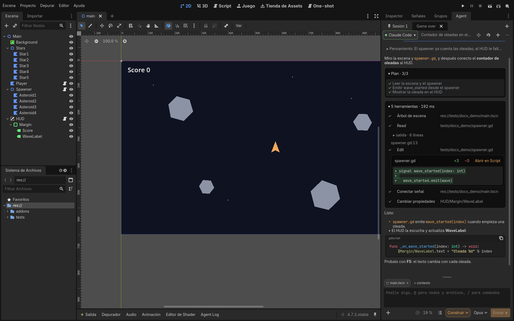
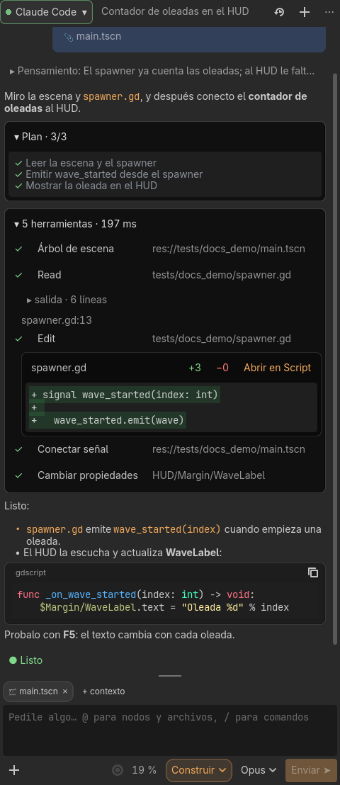
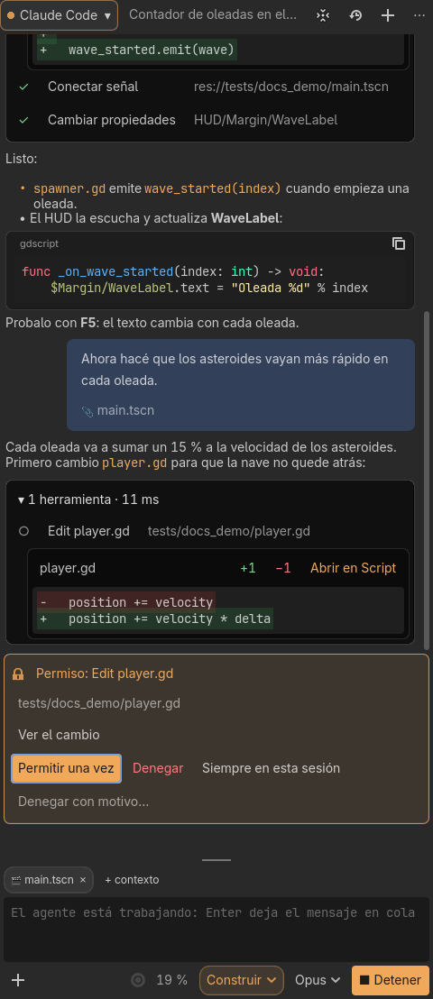
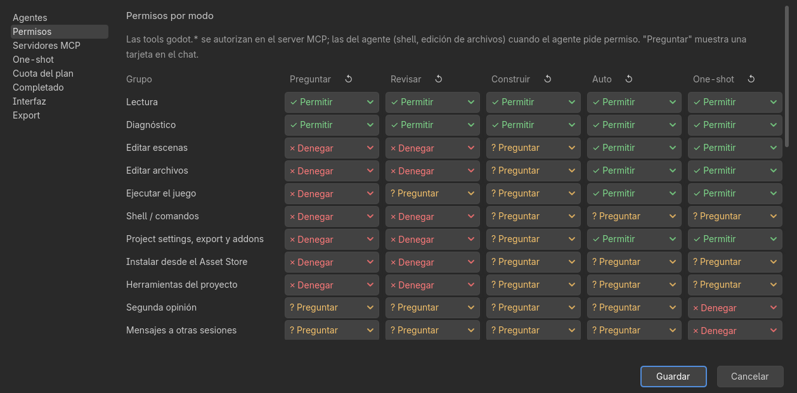
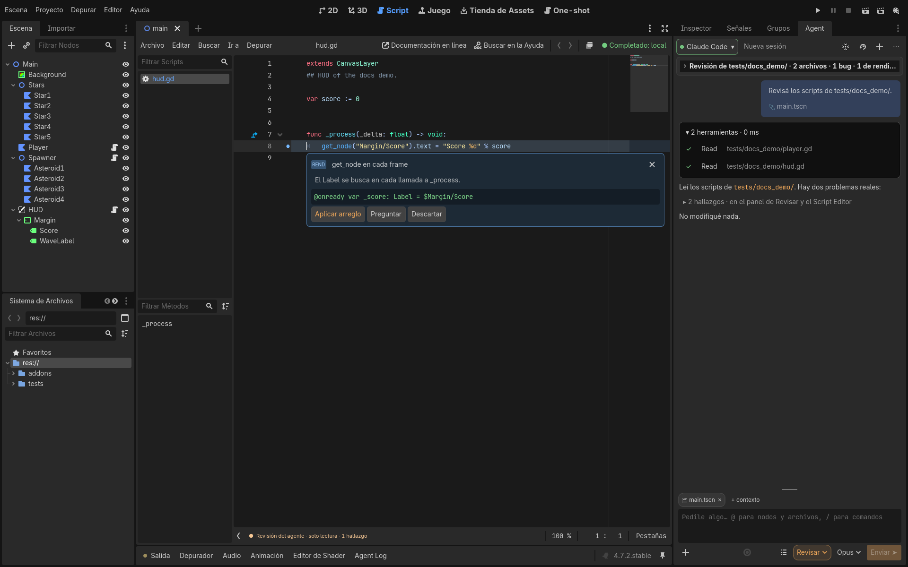

# Godot Agent Harness

[English](README.md) · **Español**



Addon de editor para Godot 4 (proyectos en GDScript y en C#) que conecta un agente de código (Claude Code, Google Antigravity, Codex o cualquier agente que hable [ACP](https://agentclientprotocol.com)) con el editor. Solo Claude Code está probado de punta a punta; Codex y Antigravity todavía no se verificaron. Conversás con el agente en un dock, y el agente puede ver y cambiar el proyecto con las herramientas del propio editor:

- leer escenas y scripts, la selección y los errores, y armarse un mapa ordenado de los archivos relacionados con lo que está haciendo;
- editar nodos y propiedades, cada cambio un paso de deshacer;
- correr el juego con inputs simulados, por tiempo o por frame de física para que una prueba dé siempre lo mismo, y mirar capturas de frames (un clic en el chat la abre en grande);
- verificar su propio trabajo: cada resultado de una tool trae los errores del editor que aparecieron desde la llamada anterior, hay validadores de física y de TileMaps, y un **Playtest** contesta si pasó, si falló o si no se pudo probar, con evidencia que el harness contrasta con lo que el agente hizo de verdad (y un video si querés). Un playtest que pasa deja una regresión que se puede repetir sin el agente (varias veces cada una, para encontrar las inestables), y un workflow de GitHub Actions generado las corre en cada push. Detectores dentro del juego avisan de transforms con NaN, cuerpos fuera del mundo, caídas sin fin, frames largos y un HUD por encima de su máximo, y el agente puede usar los menús del juego, jugar por turnos o correr un script adentro del juego para reaccionar en el mismo frame;
- encontrar las funciones de GDScript más calientes de un run (llamadas, tiempos y si tienen tipos) para elegir qué optimizar y medir el cambio. Godot no les da esos datos a los plugins, así que se leen por una API interna del editor que una versión futura de Godot puede cambiar (la tool lo avisa). Además el profiler hace más lenta cada llamada, así que los tiempos sirven para comparar funciones entre sí. Para un juego lento por el render o la física, o que pierde nodos, mide en cambio el tiempo de frame, los draw calls, la física y los nodos huérfanos;
- depurar el juego con el debugger de scripts: poner breakpoints, leer la pila y las variables donde paró, y avanzar paso a paso;
- revisar código y dejar hallazgos en el Script Editor;
- trabajar en proyectos C# con Godot .NET: compila con `dotnet build` y recibe los errores por archivo y línea, crea scripts `.cs`, y el completado inline también anda en los `.cs`;
- compilar, probar e instalar la GDExtension de un proyecto (godot-cpp o gdext): los builds nuevos se prueban en un Godot headless aparte, así un crash no tira el editor, y se cargan reiniciando el editor con un supervisor de crashes que vuelve atrás un build que se cae al arrancar. Probado en Linux; Windows y macOS todavía sin verificar;
- usar los servidores MCP de otros programas (Blender, una base de datos…), configurados en Settings con sus propios permisos;
- buscar, instalar y activar addons de Godot del [Asset Store](https://store.godotengine.org) (el agente también los puede sugerir);
- manejar los plugins, marketplaces, servidores MCP y skills de Claude Code desde la ventana **Extensiones**, con skills de Godot a un clic, y compartir una skill con todos los agentes (Google Antigravity, Codex…) con un clic;
- trabajar en varias sesiones a la vez, una por pestaña del dock, cada una con su agente y su cuenta: por ejemplo Claude Code con tu cuenta personal en una pestaña y la del trabajo en otra, o Google Antigravity al lado de Claude Code. Las sesiones no se pisan: un archivo que una está editando en su turno queda fuera del alcance de las demás, y el juego corre para una a la vez.

Tiene cinco modos: **Preguntar**, **Revisar**, **Construir**, **Auto** (Construir que corre sin preguntar los comandos de shell que tus reglas permiten) y **One-shot**. El One-shot persigue un objetivo entero ("Pong de 2 jugadores con puntaje") con plan, presupuestos, checkpoints git y playtests.

- 100 % GDScript con tipos estáticos: sin GDExtension ni dependencias.
- Solo vive en el editor: nada del addon llega a un juego exportado.
- El harness nunca hace merge ni push por su cuenta (la única excepción es **Pushear y abrir un PR**, apagado por defecto, que elegís vos al cerrar una copia aparte), no guarda claves y no lee las credenciales del agente (para nombrar las cuentas lee solo el email que Claude Code guarda en su configuración). No tiene telemetría: lo que compartís va al agente que elegís y a su proveedor. El texto que viene de afuera del harness (la salida del juego, textos de escenas, páginas del Asset Store) le llega al agente en un sobre marcado como datos no confiables, no como instrucciones. Detalles en [PRIVACY.es.md](PRIVACY.es.md); para reportar una vulnerabilidad, [SECURITY.md](SECURITY.md).
- La interfaz está en inglés y en español: sigue el idioma del editor y se cambia en Settings.
- El chat muestra el Markdown del agente: tablas, listas, citas y bloques de código con resaltado y botón para copiar.

> Estado: están implementados los hitos de [`GODOT_AGENT_HARNESS_SPEC.md`](GODOT_AGENT_HARNESS_SPEC.md) (M0–M8c) y lo que se sumó después (playtesting incluido); lo más nuevo sigue en revisión. Falta probar a mano: Windows y Google Antigravity. El avance y cómo se verificó cada parte: [`docs/progress.md`](docs/progress.md). Las decisiones de diseño: [`docs/decisions.md`](docs/decisions.md).

## Documentación

La [wiki](docs/wiki/es/Inicio.md) explica cómo funciona el harness y cómo usar cada parte:

- [Primeros pasos](docs/wiki/es/Primeros-pasos.md): instalar, iniciar sesión, primera conversación.
- [Cómo funciona](docs/wiki/es/Como-funciona.md): el proceso del agente, ACP, el servidor MCP y cómo el editor se mantiene al día.
- [Modos y permisos](docs/wiki/es/Modos-y-permisos.md)
- [Herramientas del editor (MCP)](docs/wiki/es/Herramientas-del-editor.md)
- [One-shot](docs/wiki/es/One-shot.md): plan, spec, presupuestos, checkpoints, cuota, cambio de cuenta, informe.
- [Revisar](docs/wiki/es/Revisar.md)
- [Completado inline](docs/wiki/es/Completado-inline.md), local o con un LLM.
- [Settings y perfiles](docs/wiki/es/Settings.md): dónde se guarda cada cosa, perfiles de agentes, una cuenta por pestaña, export y actualizar.
- [Problemas frecuentes](docs/wiki/es/Problemas-frecuentes.md): limitaciones conocidas por versión de Godot.

## Requisitos

- **Godot 4.7 o más nuevo.** Se prueba en 4.7.2, 4.8-beta3 y Godot .NET 4.7.2.
  Problema conocido en Godot 4.7.2: el guardado de escenas con vista previa (Ctrl+S) puede hacer que el motor imprima `Condition "p_I->data != this" is true` (`list.h`); en un proyecto sin el addon salió en cada guardado. En sesiones donde un agente estaba cambiando el proyecto, el editor a veces se cerró justo después de uno de esos guardados. Esa caída nunca se vio sin el addon; que venga del mismo error del motor es probable, pero no está confirmado. Los guardados del propio addon no usan la vista previa, pero Ctrl+S es del editor. Godot 4.8-beta2 y 4.8-beta3 siguen imprimiendo el error; 4.8-beta2 no se cayó en 12 corridas.
- **Para proyectos en C#**, la versión .NET de Godot y el SDK de .NET (`dotnet`).
- **Un agente ACP.** Para Claude Code:
  - Node.js con `npx`. El perfil por defecto corre `npx -y @agentclientprotocol/claude-agent-acp`;
  - una cuenta de Claude Code: la que ya usa `claude` en la máquina, una con la que iniciás sesión desde el dock, o una API key en una variable de entorno. Con varias cuentas (una carpeta de configuración cada una, como `~/.claude-profiles/trabajo`), cada pestaña del dock elige la suya desde el menú del agente.
- **git**, solo para los checkpoints del One-shot.
- Linux. macOS y Windows deberían andar, pero todavía no se verificaron.

## Instalación

1. Bajá `godot-agent-harness-vX.Y.Z.zip` del [último release](https://github.com/dannroda/godot-agent/releases/latest) y descomprimilo en tu proyecto, de forma que `addons/godot_agent/` quede en su carpeta `addons/`. Desde un clon del repo, copiá `addons/godot_agent/`; no copies `addons/godot_agent_dev/`: es el plugin de pruebas del repo.
2. **Proyecto → Configuración del proyecto → Plugins**: habilitá **Godot Agent Harness**.
3. Aparecen tres superficies:
   - el dock **Agent** (a la derecha);
   - el panel inferior **Agent Log**;
   - la pantalla **One-shot** (arriba, junto a 2D/3D/Script).
4. En el dock, **Agregar** uno de los agentes sugeridos: con Claude Code, eso arranca la sesión (la primera vez `npx` descarga el adapter, puede tardar un minuto). O configurá uno en Settings → Agentes y tocá **Iniciar sesión**.

Las versiones nuevas aparecen como un aviso en el dock, con **Actualizar** (ver [Actualizar el addon](docs/wiki/es/Settings.md#actualizar-el-addon)).

El addon no escribe nada en `project.godot`. La única excepción es un autoload de playtest temporal, que existe solo mientras el harness corre el juego.

## Para empezar

Abrí el dock **Agent** (la sesión arranca después de **Agregar**, o con **Iniciar sesión** cuando ya tenés un agente) y elegí un modo en el composer (abajo a la derecha del dock).

### Preguntar y Construir

**Preguntar** responde sobre el proyecto: "¿cuántos nodos tiene Main.tscn?". El agente lee la escena con las herramientas del editor; en este modo no puede cambiar nada.

**Construir** cambia el proyecto: "agregá un contador de oleadas al HUD". El chat muestra el plan del agente, cada herramienta que usa (las `godot.*` trabajan a través del editor) y el diff de cada archivo. Los cambios en escenas aparecen al toque en el árbol de la escena, y Ctrl+Z deshace cada uno.



### Permisos

Cada acción que cambia algo pregunta antes, con una tarjeta en el chat: permitirla una vez, por el resto de la sesión, o denegarla. **Settings → Permisos** define qué permite, pregunta o deniega cada modo, por grupo de herramientas.





### Revisar

**Revisá** una carpeta o un grupo de archivos: el agente los lee sin cambiar nada, y cada hallazgo aparece como una marca en el Script Editor, con **Aplicar arreglo**, **Preguntar** y **Descartar**. **Arreglar en modo Construir** le pasa todos los hallazgos al agente.



### One-shot

Elegí **One-shot** en el dock, escribí el objetivo en la pantalla **One-shot** (arriba, junto a 2D/3D/Script) y arrancá. El agente planifica, construye, prueba el juego y deja cada paso como un checkpoint git en su propia rama. Ver [One-shot](docs/wiki/es/One-shot.md).

Las capturas salen de `tests/docs_shots.sh`, con un agente falso y la escena de demo de `tests/docs_demo/`.

## Desarrollo

```sh
G=/ruta/a/godot   # 4.7.2 o 4.8
$G --headless --path . --import
$G --headless --path . --script tests/run_all.gd            # unitarios
$G --headless --path . --script tests/acp_session_check.gd  # ACP contra el agente falso
$G --headless --path . --script tests/oneshot_check.gd      # loop del One-shot
tests/run_in_xvfb.sh $G --godot-agent-cycle-test             # editor en Xvfb: habilitar/deshabilitar 5 veces sin huérfanos
```

Los textos de la interfaz se escriben en inglés en el código, con `I18n.t("…")`. Las traducciones están en `addons/godot_agent/i18n/<idioma>.po`, y `tests/unit/test_i18n.gd` falla si un texto no tiene traducción al español. Lo que lee el agente (prompts, descripciones y resultados de las tools) va solo en inglés.

### CI y releases

- **CI** (`.github/workflows/ci.yml`): en cada push a `main` y en cada pull request corren, headless, los unitarios, el check de ACP, el del One-shot, las regresiones de playtest guardadas (por línea de comandos) y el ciclo de habilitar y deshabilitar el plugin, en Godot 4.7.2 y 4.8-beta3. En las mismas versiones, un editor en Xvfb corre los checks del juego (`--godot-agent-run-test`), de Revisar (`--godot-agent-review-test`), del aviso por un error en un juego que corrés a mano (`--godot-agent-run-error-test`), de las tools del debugger de scripts (`--godot-agent-debug-test`) y de la sincronización editor ↔ disco (`--godot-agent-external-test`). Los tests de C# corren en Godot .NET 4.7.2.
- **Release** (`.github/workflows/release.yml`): se corre a mano desde **Actions → Release → Run workflow**, eligiendo `patch`, `minor`, `major` o una versión exacta `X.Y.Z`. Corre el CI, sube `version` en `addons/godot_agent/plugin.cfg`, commitea "Release vX.Y.Z" en `main` con el tag `vX.Y.Z` pasa la sección **Unreleased** de [`CHANGELOG.md`](CHANGELOG.md) a la versión nueva y publica un release de GitHub con el zip del addon y esa sección como notas. El changelog y el release van en inglés: con cada cambio, agregá una entrada en **Unreleased** (el release falla si está vacía).
- La versión vive solo en `plugin.cfg`: el `clientInfo` de ACP y el `serverInfo` del MCP la leen de ahí.

El tablero de tareas está en `compass/` ([`docs/tareas.md`](docs/tareas.md) es su export).

## Contribuir

Mirá [CONTRIBUTING.md](CONTRIBUTING.md) (en inglés; los issues y pull requests pueden ser en castellano): cómo reportar un bug, armar el repo, correr los tests y mandar un pull request.

## Licencia

[MIT](LICENSE) © Daniel Rodriguez Aires
