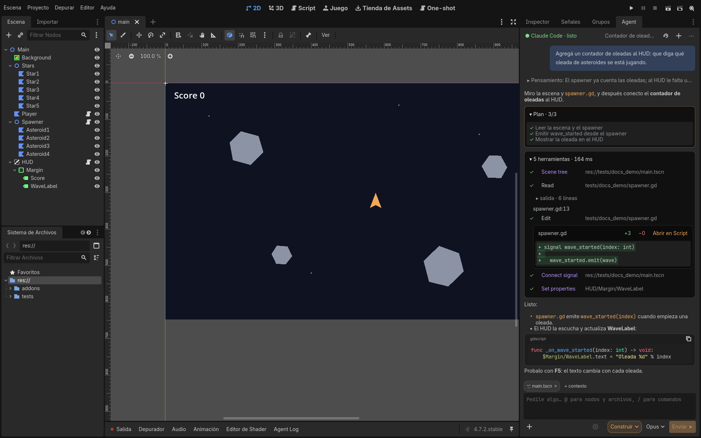
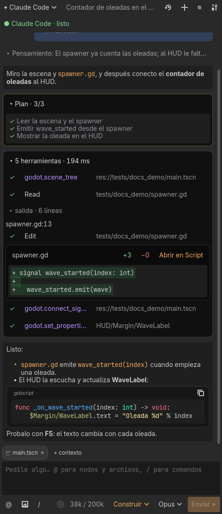
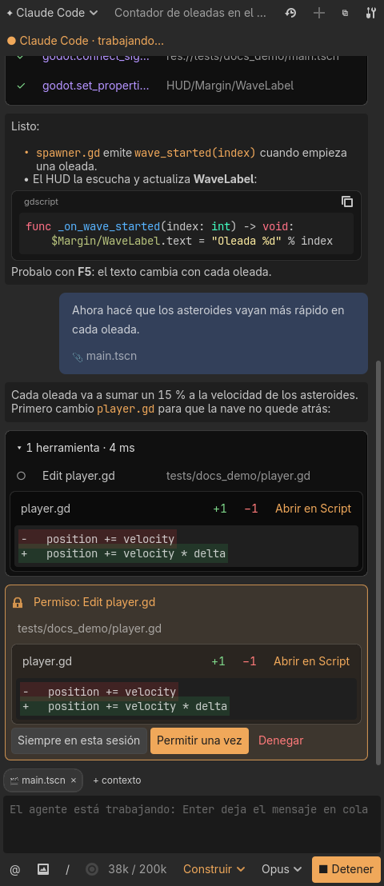
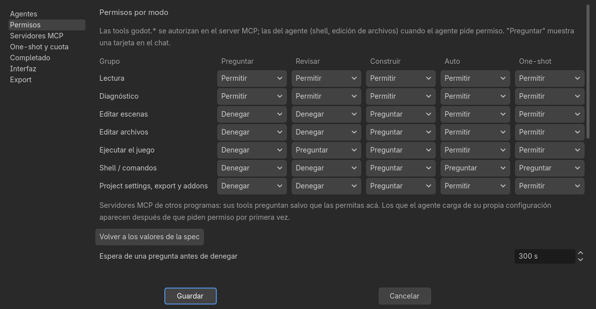
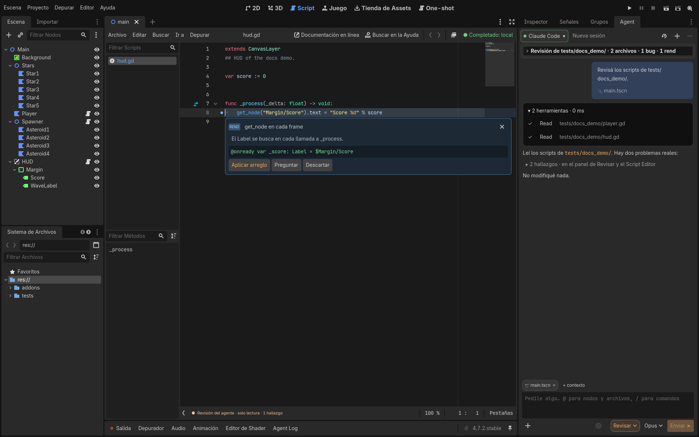

# Godot Agent Harness

[English](README.md) · **Español**



Addon de editor para Godot 4 que conecta un agente de código (Claude Code, Google Antigravity, Codex o cualquier agente que hable [ACP](https://agentclientprotocol.com)) con el editor. Conversás con el agente en un dock, y el agente puede ver y cambiar el proyecto con las herramientas del propio editor:

- leer escenas y scripts, la selección y los errores;
- editar nodos y propiedades, cada cambio un paso de deshacer;
- correr el juego con inputs simulados y mirar capturas de frames (un clic en el chat la abre en grande);
- revisar código y dejar hallazgos en el Script Editor;
- usar los servidores MCP de otros programas (Blender, una base de datos…), configurados en Settings con sus propios permisos;
- buscar, instalar y activar addons de Godot del [Asset Store](https://store.godotengine.org) (el agente también los puede sugerir);
- manejar los plugins, marketplaces, servidores MCP y skills de Claude Code desde la ventana **Extensiones**, con skills de Godot a un clic.

Tiene cinco modos: **Preguntar**, **Revisar**, **Construir**, **Auto** (Construir que corre sin preguntar los comandos de shell que tus reglas permiten) y **One-shot**. El One-shot persigue un objetivo entero ("Pong de 2 jugadores con puntaje") con plan, presupuestos, checkpoints git y playtests.

- 100 % GDScript con tipos estáticos: sin GDExtension ni dependencias.
- Solo vive en el editor: nada del addon llega a un juego exportado.
- El harness nunca hace merge ni push, no guarda claves y no lee las credenciales del agente.
- La interfaz está en inglés y en español: sigue el idioma del editor y se cambia en Settings.
- El chat muestra el Markdown del agente: tablas, listas, citas y bloques de código con resaltado y botón para copiar.

> Estado: los hitos M0–M8c de [`GODOT_AGENT_HARNESS_SPEC.md`](GODOT_AGENT_HARNESS_SPEC.md) están implementados. El avance y cómo se verificó cada parte: [`docs/progress.md`](docs/progress.md). Las decisiones de diseño: [`docs/decisions.md`](docs/decisions.md).

## Documentación

La [wiki](docs/wiki/es/Inicio.md) explica cómo funciona el harness y cómo usar cada parte:

- [Primeros pasos](docs/wiki/es/Primeros-pasos.md): instalar, iniciar sesión, primera conversación.
- [Cómo funciona](docs/wiki/es/Como-funciona.md): el proceso del agente, ACP, el servidor MCP y cómo el editor se mantiene al día.
- [Modos y permisos](docs/wiki/es/Modos-y-permisos.md)
- [Herramientas del editor (MCP)](docs/wiki/es/Herramientas-del-editor.md)
- [One-shot](docs/wiki/es/One-shot.md): plan, spec, presupuestos, checkpoints, cuota, cambio de cuenta, informe.
- [Revisar](docs/wiki/es/Revisar.md)
- [Completado inline](docs/wiki/es/Completado-inline.md), local o con un LLM.
- [Settings y perfiles](docs/wiki/es/Settings.md): dónde se guarda cada cosa, perfiles de agentes, export y actualizar.
- [Problemas frecuentes](docs/wiki/es/Problemas-frecuentes.md): limitaciones conocidas por versión de Godot.

## Requisitos

- **Godot 4.7 o más nuevo.** Se prueba en 4.7.2 y 4.8-beta1.
- **Un agente ACP.** Para Claude Code:
  - Node.js con `npx`. El perfil por defecto corre `npx -y @agentclientprotocol/claude-agent-acp`;
  - una cuenta de Claude Code: la que ya usa `claude` en la máquina, una con la que iniciás sesión desde el dock, o una API key en una variable de entorno.
- **git**, solo para los checkpoints del One-shot.
- Linux, macOS o Windows.

## Instalación

1. Bajá `godot-agent-harness-vX.Y.Z.zip` del [último release](https://github.com/dannroda/godot-agent/releases/latest) y descomprimilo en tu proyecto, de forma que `addons/godot_agent/` quede en su carpeta `addons/`. Desde un clon del repo, copiá `addons/godot_agent/`; no copies `addons/godot_agent_dev/`: es el plugin de pruebas del repo.
2. **Proyecto → Configuración del proyecto → Plugins**: habilitá **Godot Agent Harness**.
3. Aparecen tres superficies:
   - el dock **Agent** (a la derecha);
   - el panel inferior **Agent Log**;
   - la pantalla **One-shot** (arriba, junto a 2D/3D/Script).
4. En el dock, **Agregar** uno de los agentes sugeridos (o configurá uno en Settings → Agentes) e **Iniciar sesión**. Con Claude Code, la primera vez `npx` descarga el adapter.

Las versiones nuevas aparecen como un aviso en el dock, con **Actualizar** (ver [Actualizar el addon](docs/wiki/es/Settings.md#actualizar-el-addon)).

El addon no escribe nada en `project.godot`. La única excepción es un autoload de playtest temporal, que existe solo mientras el harness corre el juego.

## Para empezar

Abrí el dock **Agent**, tocá **Iniciar sesión** y elegí un modo en el composer (abajo a la derecha del dock).

### Preguntar y Construir

**Preguntar** responde sobre el proyecto: "¿cuántos nodos tiene Main.tscn?". El agente lee la escena con las herramientas del editor; en este modo no puede cambiar nada.

**Construir** cambia el proyecto: "agregá un contador de oleadas al HUD". El chat muestra el plan del agente, cada herramienta que usa (las `godot.*` trabajan a través del editor) y el diff de cada archivo. Los cambios en escenas aparecen al toque en el árbol de la escena, y Ctrl+Z deshace cada uno.



### Permisos

Cada acción que cambia algo pregunta antes, con una tarjeta en el chat: permitirla una vez, por el resto de la sesión, o denegarla. **Settings → Permisos** define qué permite, pregunta o deniega cada modo, por grupo de herramientas.





### Revisar

**Revisá** una carpeta o un grupo de archivos: el agente los lee sin cambiar nada, y cada hallazgo aparece como una marca en el Script Editor, con **Aplicar arreglo**, **Preguntar** y **Descartar**. **Arreglar en modo Construir** le pasa todos los hallazgos al agente.



### One-shot

Elegí **One-shot** en el dock, escribí el objetivo en la pantalla **One-shot** (arriba, junto a 2D/3D/Script) y arrancá. El agente planifica, construye, prueba el juego y deja cada paso como un checkpoint git en su propia rama. Ver [One-shot](docs/wiki/es/One-shot.md).

Las capturas salen de `tests/docs_shots.sh`, con un agente falso y la escena de demo de `tests/docs_demo/`.

## Desarrollo

```sh
G=/ruta/a/godot   # 4.7.2 o 4.8
$G --headless --path . --import
$G --headless --path . --script tests/run_all.gd            # unitarios
$G --headless --path . --script tests/acp_session_check.gd  # ACP contra el agente falso
$G --headless --path . --script tests/oneshot_check.gd      # loop del One-shot
tests/run_in_xvfb.sh $G --godot-agent-cycle-test             # editor en Xvfb: habilitar/deshabilitar 5 veces sin huérfanos
```

Los textos de la interfaz se escriben en inglés en el código, con `I18n.t("…")`. Las traducciones están en `addons/godot_agent/i18n/<idioma>.po`, y `tests/unit/test_i18n.gd` falla si un texto no tiene traducción al español. Lo que lee el agente (prompts, descripciones y resultados de las tools) va solo en inglés.

### CI y releases

- **CI** (`.github/workflows/ci.yml`): en cada push a `main` y en cada pull request corren, headless, los unitarios, el check de ACP y el del One-shot, en Godot 4.7.2 y 4.8-beta1.
- **Release** (`.github/workflows/release.yml`): se corre a mano desde **Actions → Release → Run workflow**, eligiendo `patch`, `minor`, `major` o una versión exacta `X.Y.Z`. Corre el CI, sube `version` en `addons/godot_agent/plugin.cfg`, commitea "Release vX.Y.Z" en `main` con el tag `vX.Y.Z` pasa la sección **Unreleased** de [`CHANGELOG.md`](CHANGELOG.md) a la versión nueva y publica un release de GitHub con el zip del addon y esa sección como notas. El changelog y el release van en inglés: con cada cambio, agregá una entrada en **Unreleased** (el release falla si está vacía).
- La versión vive solo en `plugin.cfg`: el `clientInfo` de ACP y el `serverInfo` del MCP la leen de ahí.

El tablero de tareas está en `compass/` ([`docs/tareas.md`](docs/tareas.md) es su export).

## Contribuir

Mirá [CONTRIBUTING.md](CONTRIBUTING.md) (en inglés; los issues y pull requests pueden ser en castellano): cómo reportar un bug, armar el repo, correr los tests y mandar un pull request.

## Licencia

[MIT](LICENSE) © Daniel Rodriguez Aires
