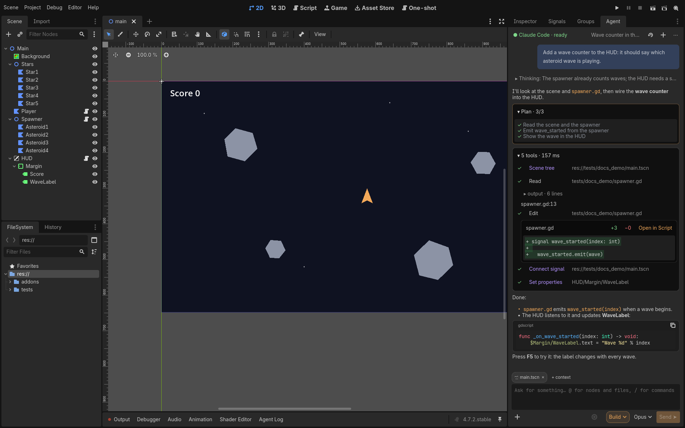
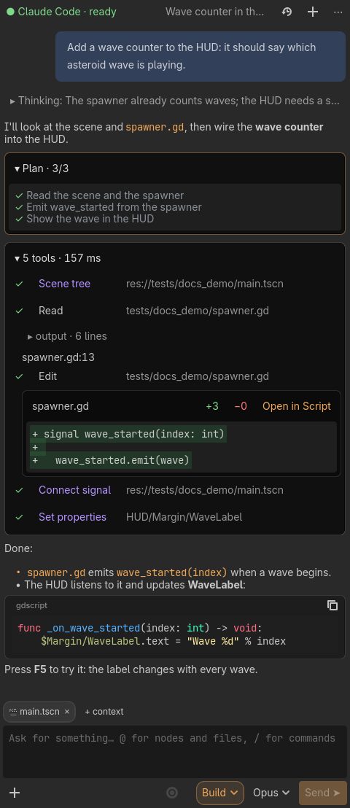
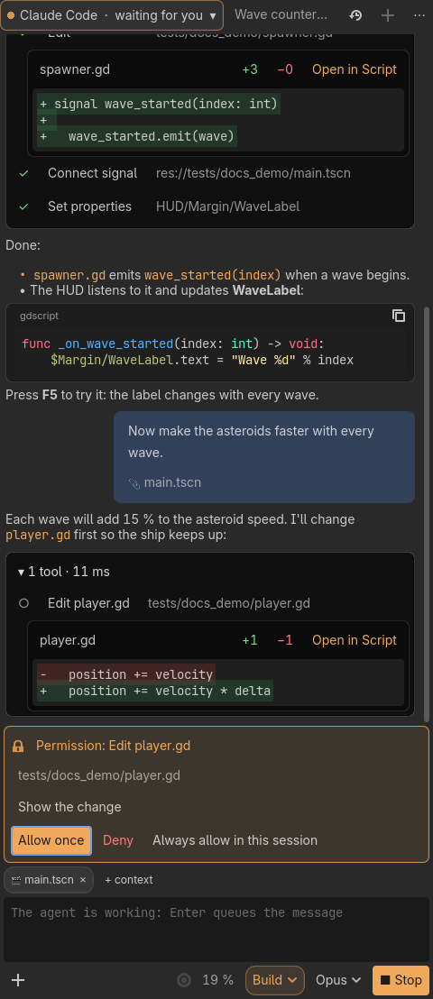
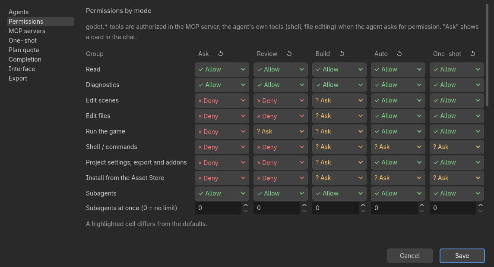
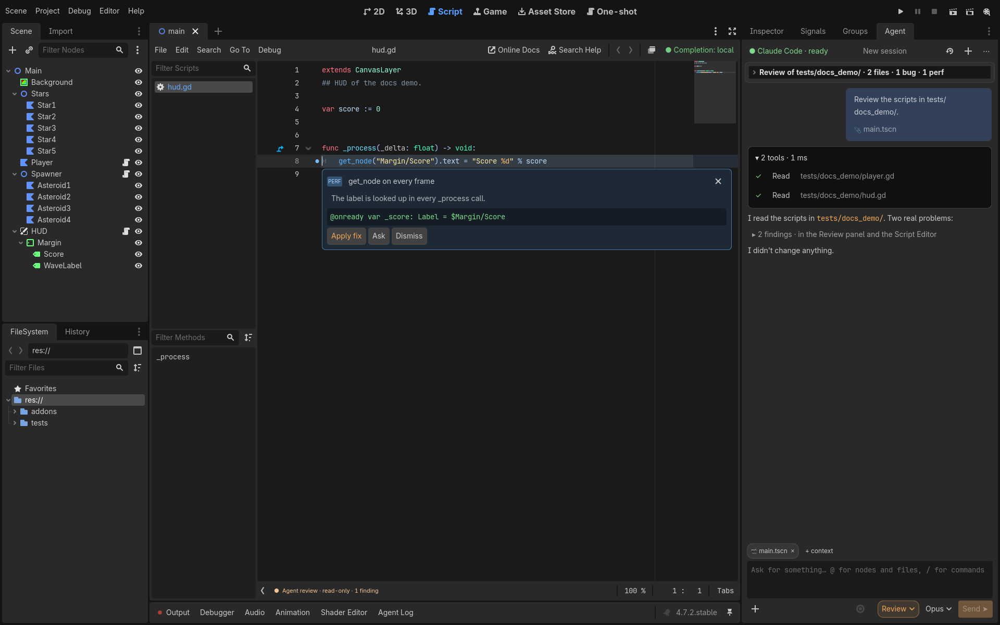

# Godot Agent Harness

**English** · [Español](README.es.md)



An editor addon for Godot 4 that connects a coding agent (Claude Code, Gemini CLI, Codex, or any agent that speaks [ACP](https://agentclientprotocol.com)) to the editor. You chat with the agent in a dock, and it can see and change your project through the editor's own tools:

- read scenes and scripts, the selection and the errors;
- edit nodes and properties, each change one undo step;
- run the game with simulated input and look at captured frames (click one in the chat to see it full size);
- review code and leave findings in the Script Editor;
- use the MCP servers of other programs (Blender, a database…), set up in Settings with their own permissions;
- find, install and enable Godot addons from the [Asset Store](https://store.godotengine.org) (the agent can suggest them too);
- manage Claude Code's plugins, marketplaces and MCP servers from the **Extensions** window.

It has five modes: **Ask**, **Review**, **Build**, **Auto** (Build that runs the shell commands your rules allow without asking) and **One-shot**. One-shot pursues a whole goal ("a 2-player Pong with score") with a plan, budgets, git checkpoints and playtests.

- 100 % statically typed GDScript: no GDExtension, no dependencies.
- Editor-only: nothing from the addon ends up in an exported game.
- The harness never merges or pushes, never stores keys and never reads the agent's credentials.
- The interface is in English and Spanish (it follows the editor language; you can change it in Settings).
- The chat renders the agent's Markdown: tables, lists, quotes, and code blocks with highlighting and a copy button.

> Status: milestones M0–M8c of [`GODOT_AGENT_HARNESS_SPEC.md`](GODOT_AGENT_HARNESS_SPEC.md) are implemented. Progress and how each part was verified: [`docs/progress.md`](docs/progress.md). Design decisions: [`docs/decisions.md`](docs/decisions.md). Both are in Spanish.

## Documentation

The [wiki](docs/wiki/en/Home.md) explains how the harness works and how to use each part:

- [Getting started](docs/wiki/en/Getting-started.md): install, sign in, first conversation.
- [How it works](docs/wiki/en/How-it-works.md): the agent process, ACP, the MCP server and how the editor stays in sync.
- [Modes and permissions](docs/wiki/en/Modes-and-permissions.md)
- [Editor tools (MCP)](docs/wiki/en/Editor-tools.md)
- [One-shot](docs/wiki/en/One-shot.md): plan, spec, budgets, checkpoints, quota, switching accounts, report.
- [Review](docs/wiki/en/Review.md)
- [Inline completion](docs/wiki/en/Inline-completion.md), local or with an LLM.
- [Settings and profiles](docs/wiki/en/Settings.md): where everything is stored, agent profiles, export and updating.
- [Troubleshooting](docs/wiki/en/Troubleshooting.md): known limitations by Godot version.

## Requirements

- **Godot 4.6 or newer.** Tested on 4.6.3, 4.7.2 and 4.8-beta1.
- **An ACP agent.** For Claude Code:
  - Node.js with `npx`. The default profile runs `npx -y @agentclientprotocol/claude-agent-acp`;
  - a Claude Code account: the one `claude` already uses on your machine, one you sign in to from the dock, or an API key in an environment variable.
- **git**, only for One-shot checkpoints.
- Linux, macOS or Windows.

## Install

1. Download `godot-agent-harness-vX.Y.Z.zip` from the [latest release](https://github.com/dannroda/godot-agent/releases/latest) and unzip it into your project, so that `addons/godot_agent/` ends up in its `addons/` folder. From a clone of this repository, copy `addons/godot_agent/` instead; don't copy `addons/godot_agent_dev/`: it's this repository's test plugin.
2. **Project → Project Settings → Plugins**: enable **Godot Agent Harness**.
3. Three surfaces appear:
   - the **Agent** dock (right side);
   - the **Agent Log** bottom panel;
   - the **Agent** screen (top bar, next to 2D/3D/Script), where One-shot runs.
4. Click **Start session** in the dock. With Claude Code, `npx` downloads the adapter the first time.

New versions show up as a notice in the dock, with **Update** (see [Updating the addon](docs/wiki/en/Settings.md#updating-the-addon)).

The addon writes nothing to `project.godot`. The one exception is a temporary playtest autoload, added only while the harness runs the game.

## Quick start

Open the **Agent** dock, click **Start session** and pick a mode in the composer (bottom right of the dock).

### Ask and Build

**Ask** answers questions about the project: "How many nodes does Main.tscn have?". The agent reads the scene with the editor tools; it can't change anything in this mode.

**Build** changes the project: "Add a wave counter to the HUD". The chat shows the agent's plan, every tool it calls (the `godot.*` ones work through the editor) and the diff of each file. Scene edits show up in the scene tree right away, and Ctrl+Z undoes each one.



### Permissions

Each action that changes something asks first, in a card in the chat: allow it once, for the rest of the session, or deny it. **Settings → Permissions** sets what each mode allows, asks or denies, per group of tools.





### Review

**Review** a folder or a set of files: the agent reads them without changing anything, and each finding shows up as a mark in the Script Editor, with **Apply fix**, **Ask** and **Dismiss**. **Fix in Build mode** hands every finding to the agent.



### One-shot

Pick **One-shot** in the dock, write the goal in the **Agent** screen (top bar, next to 2D/3D/Script) and start. The agent plans, builds, playtests and leaves every step as a git checkpoint on its own branch. See [One-shot](docs/wiki/en/One-shot.md).

The screenshots come from `tests/docs_shots.sh`, with a fake agent and the demo scene in `tests/docs_demo/`.

## Development

```sh
G=/path/to/godot   # 4.6.3, 4.7.2 or 4.8
$G --headless --path . --import
$G --headless --path . --script tests/run_all.gd            # unit tests
$G --headless --path . --script tests/acp_session_check.gd  # ACP against the fake agent
$G --headless --path . --script tests/oneshot_check.gd      # One-shot loop
tests/run_in_xvfb.sh $G --godot-agent-cycle-test             # editor in Xvfb: enable/disable 5 times without leaks
```

The interface text is written in English in the code, wrapped in `I18n.t("…")`. Translations live in `addons/godot_agent/i18n/<language>.po`; `tests/unit/test_i18n.gd` fails if a text has no Spanish translation. What the agent reads (prompts, tool descriptions and results) is English only.

### CI and releases

- **CI** (`.github/workflows/ci.yml`): on every push to `main` and every pull request, the unit tests, the ACP check and the One-shot check run headless on Godot 4.6.3, 4.7.2 and 4.8-beta1.
- **Release** (`.github/workflows/release.yml`): run it by hand from **Actions → Release → Run workflow**, choosing `patch`, `minor`, `major` or an exact `X.Y.Z`. It runs the CI, bumps `version` in `addons/godot_agent/plugin.cfg`, commits "Release vX.Y.Z" to `main` with the tag `vX.Y.Z`, moves the **Unreleased** section of [`CHANGELOG.md`](CHANGELOG.md) under the new version, and publishes a GitHub release with the zip of the addon and that section as notes. The changelog and the release are in English: add an entry under **Unreleased** with each change (the release fails if it's empty).
- The version lives only in `plugin.cfg`: the ACP `clientInfo` and the MCP `serverInfo` read it from there.

The task board lives in `compass/` ([`docs/tareas.md`](docs/tareas.md) is its export).

## Contributing

See [CONTRIBUTING.md](CONTRIBUTING.md): how to report a bug, set up the repository, run the tests and send a pull request.

## License

[MIT](LICENSE) © Daniel Rodriguez Aires
