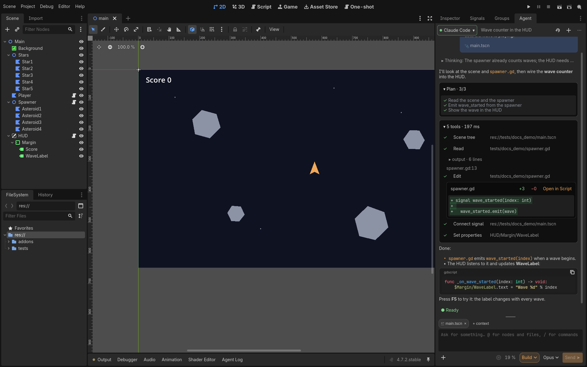
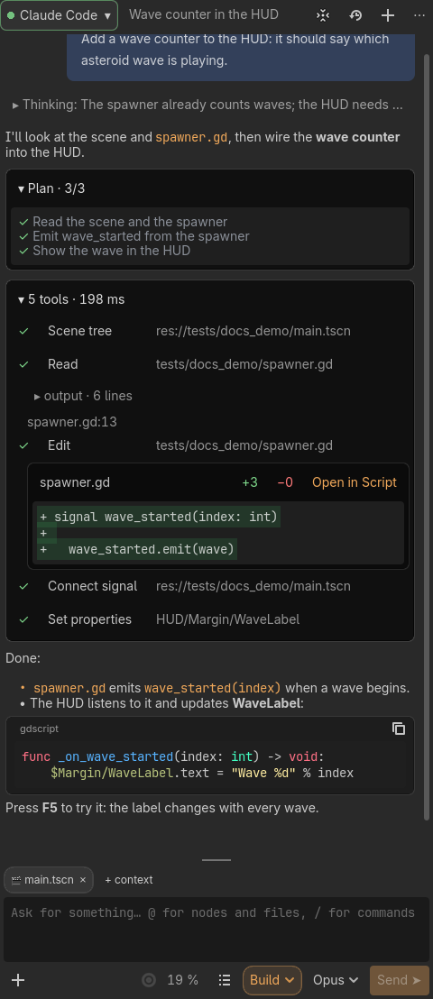
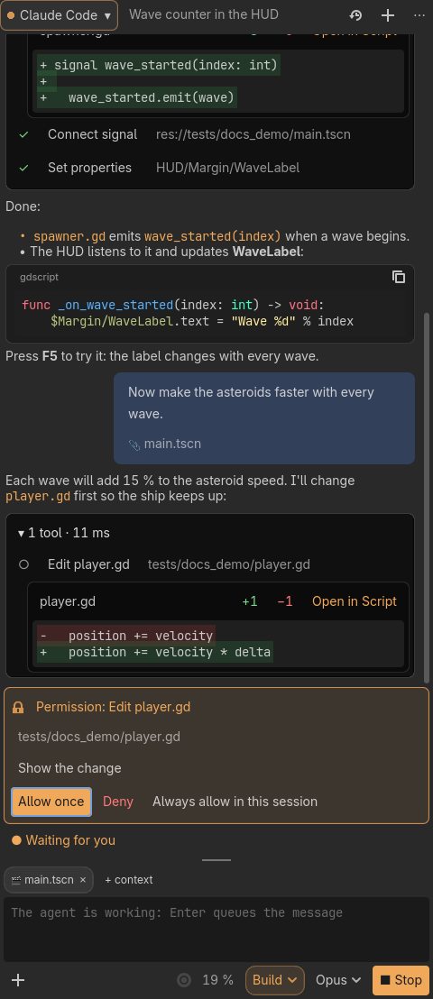
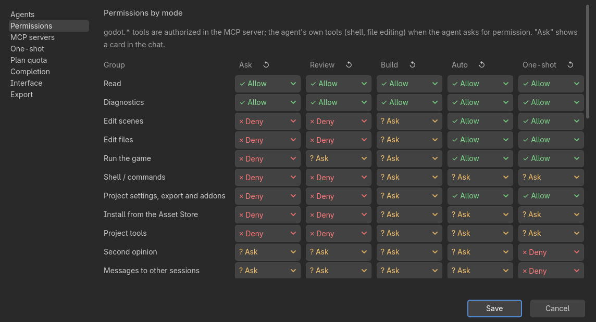
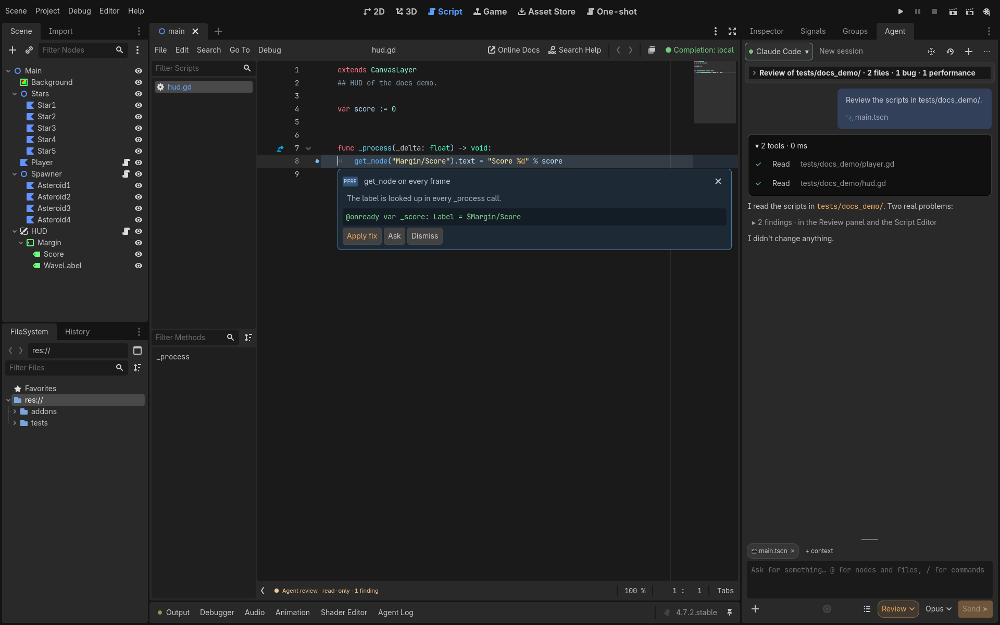

# Godot Agent Harness

**English** · [Español](README.es.md)



An editor addon for Godot 4 (GDScript and C# projects) that connects a coding agent (Claude Code, Google Antigravity, Codex, or any agent that speaks [ACP](https://agentclientprotocol.com)) to the editor. Only Claude Code has been tested end to end; Codex and Antigravity haven't been verified yet. You chat with the agent in a dock, and it can see and change your project through the editor's own tools:

- read scenes and scripts, the selection and the errors, and get a ranked map of the files related to what it's working on;
- edit nodes and properties, each change one undo step;
- run the game with simulated input, by time or by physics frame so a test plays the same every time, and look at captured frames (click one in the chat to see it full size);
- check its own work: each tool result brings the editor errors that appeared since the last call, validators check physics and TileMaps, and a **Playtest** answers passed, failed or could not test, with evidence the harness checks against what the agent really did (and a video if you want). A playtest that passes leaves a regression you can rerun without the agent (several times each, to catch flaky ones), and a generated GitHub Actions workflow runs them on every push. In-game detectors catch NaN transforms, bodies out of the world, long falls, long frames and a HUD past its maximum, and the agent can use the game's menus, play turn by turn or run a script inside the game to react in the same frame;
- find the hottest GDScript functions of a run (calls, times, and whether they're typed) to pick what to optimize and measure the change. Godot doesn't give this data to plugins, so it's read through an internal editor API that a future Godot version may change (the tool then says so). The profiler also slows every call, so the times are for comparing functions with each other. For a game that is slow because of rendering or physics, or that leaks nodes, it measures frame time, draw calls, physics and orphan nodes instead;
- debug the game with the script debugger: set breakpoints, read the call stack and variables where it stopped, and step;
- review code and leave findings in the Script Editor;
- work on C# projects with Godot .NET: it compiles with `dotnet build` and gets the errors by file and line, creates `.cs` scripts, and inline completion works in `.cs` files too;
- build, test and install a project's GDExtension (godot-cpp or gdext): new builds are tested in a separate headless Godot, so a crash doesn't take the editor down, and are loaded with an editor restart under a crash supervisor that rolls back a build that crashes on start. Tested on Linux; Windows and macOS are not verified yet;
- use the MCP servers of other programs (Blender, a database…), set up in Settings with their own permissions;
- find, install and enable Godot addons from the [Asset Store](https://store.godotengine.org) (the agent can suggest them too);
- manage Claude Code's plugins, marketplaces, MCP servers and skills from the **Extensions** window, with Godot skills one click away, and share a skill with every agent (Google Antigravity, Codex…) in one click;
- work in several sessions at once, one per dock tab, each with its own agent and account: for example Claude Code with your personal account in one tab and your work account in another, or Google Antigravity next to Claude Code. Sessions don't step on each other: a file one is editing in its turn is off limits to the rest, and the game runs for one at a time.

It has five modes: **Ask**, **Review**, **Build**, **Auto** (Build that runs the shell commands your rules allow without asking) and **One-shot**. One-shot pursues a whole goal ("a 2-player Pong with score") with a plan, budgets, git checkpoints and playtests.

- 100 % statically typed GDScript: no GDExtension, no dependencies.
- Editor-only: nothing from the addon ends up in an exported game.
- The harness never merges, never pushes on its own (the one exception is **Push and open a PR**, off by default, which you choose when closing a separate copy), never stores keys and never reads the agent's credentials (to label accounts it reads only the email Claude Code keeps in its configuration). It has no telemetry: what you share goes to the agent you choose and its provider. Text from outside the harness (the game's output, scene texts, Asset Store pages) reaches the agent in an envelope marked as untrusted data, not instructions. Details in [PRIVACY.md](PRIVACY.md); to report a vulnerability, [SECURITY.md](SECURITY.md).
- The interface is in English and Spanish (it follows the editor language; you can change it in Settings).
- The chat renders the agent's Markdown: tables, lists, quotes, and code blocks with highlighting and a copy button.

> Status: the milestones of [`GODOT_AGENT_HARNESS_SPEC.md`](GODOT_AGENT_HARNESS_SPEC.md) (M0–M8c) and the work added later (playtesting included) are implemented; the newest parts are still under review. Still to verify by hand: Windows and Google Antigravity. Progress and how each part was verified: [`docs/progress.md`](docs/progress.md). Design decisions: [`docs/decisions.md`](docs/decisions.md). Both are in Spanish.

## Documentation

The [wiki](docs/wiki/en/Home.md) explains how the harness works and how to use each part:

- [Getting started](docs/wiki/en/Getting-started.md): install, sign in, first conversation.
- [How it works](docs/wiki/en/How-it-works.md): the agent process, ACP, the MCP server and how the editor stays in sync.
- [Modes and permissions](docs/wiki/en/Modes-and-permissions.md)
- [Editor tools (MCP)](docs/wiki/en/Editor-tools.md)
- [One-shot](docs/wiki/en/One-shot.md): plan, spec, budgets, checkpoints, quota, switching accounts, report.
- [Review](docs/wiki/en/Review.md)
- [Inline completion](docs/wiki/en/Inline-completion.md), local or with an LLM.
- [Settings and profiles](docs/wiki/en/Settings.md): where everything is stored, agent profiles, one account per tab, export and updating.
- [Troubleshooting](docs/wiki/en/Troubleshooting.md): known limitations by Godot version.

## Requirements

- **Godot 4.7 or newer.** Tested on 4.7.2, 4.8-beta2 and Godot .NET 4.7.2.
  Known issue on Godot 4.7.2: saving a scene with preview (Ctrl+S) can make the engine print `Condition "p_I->data != this" is true` (`list.h`); in a project without the addon it appeared on every save. In sessions where an agent was changing the project, the editor sometimes crashed right after such a save. That crash was never seen without the addon; that it comes from the same engine error is likely but not confirmed. The addon's own saves skip the preview, but Ctrl+S belongs to the editor. Godot 4.8-beta2 still prints the error, though it didn't crash in 12 runs.
- **For C# projects**, the .NET version of Godot and the .NET SDK (`dotnet`).
- **An ACP agent.** For Claude Code:
  - Node.js with `npx`. The default profile runs `npx -y @agentclientprotocol/claude-agent-acp`;
  - a Claude Code account: the one `claude` already uses on your machine, one you sign in to from the dock, or an API key in an environment variable. With several accounts (one configuration folder each, such as `~/.claude-profiles/work`), each dock tab picks its own from the agent menu.
- **git**, only for One-shot checkpoints.
- Linux. macOS and Windows should work but haven't been verified yet.

## Install

1. Download `godot-agent-harness-vX.Y.Z.zip` from the [latest release](https://github.com/dannroda/godot-agent/releases/latest) and unzip it into your project, so that `addons/godot_agent/` ends up in its `addons/` folder. From a clone of this repository, copy `addons/godot_agent/` instead; don't copy `addons/godot_agent_dev/`: it's this repository's test plugin.
2. **Project → Project Settings → Plugins**: enable **Godot Agent Harness**.
3. Three surfaces appear:
   - the **Agent** dock (right side);
   - the **Agent Log** bottom panel;
   - the **One-shot** screen (top bar, next to 2D/3D/Script).
4. In the dock, **Add** one of the suggested agents: with Claude Code, that starts the session (the first time, `npx` downloads the adapter, which can take a minute). Or set one up in Settings → Agents and click **Start session**.

New versions show up as a notice in the dock, with **Update** (see [Updating the addon](docs/wiki/en/Settings.md#updating-the-addon)).

The addon writes nothing to `project.godot`. The one exception is a temporary playtest autoload, added only while the harness runs the game.

## Quick start

Open the **Agent** dock (the session starts after **Add**, or with **Start session** once you have an agent) and pick a mode in the composer (bottom right of the dock).

### Ask and Build

**Ask** answers questions about the project: "How many nodes does Main.tscn have?". The agent reads the scene with the editor tools; it can't change anything in this mode.

**Build** changes the project: "Add a wave counter to the HUD". The chat shows the agent's plan, every tool it calls (the `godot.*` ones work through the editor) and the diff of each file. Scene edits show up in the scene tree right away, and Ctrl+Z undoes each one.



### Permissions

Each action that changes something asks first, in a card in the chat: allow it once, for the rest of the session, or deny it. **Settings → Permissions** sets what each mode allows, asks or denies, per group of tools.





### Review

**Review** a folder or a set of files: the agent reads them without changing anything, and each finding shows up as a mark in the Script Editor, with **Apply fix**, **Ask** and **Dismiss**. **Fix in Build mode** hands every finding to the agent.



### One-shot

Pick **One-shot** in the dock, write the goal in the **One-shot** screen (top bar, next to 2D/3D/Script) and start. The agent plans, builds, playtests and leaves every step as a git checkpoint on its own branch. See [One-shot](docs/wiki/en/One-shot.md).

The screenshots come from `tests/docs_shots.sh`, with a fake agent and the demo scene in `tests/docs_demo/`.

## Development

```sh
G=/path/to/godot   # 4.7.2 or 4.8
$G --headless --path . --import
$G --headless --path . --script tests/run_all.gd            # unit tests
$G --headless --path . --script tests/acp_session_check.gd  # ACP against the fake agent
$G --headless --path . --script tests/oneshot_check.gd      # One-shot loop
tests/run_in_xvfb.sh $G --godot-agent-cycle-test             # editor in Xvfb: enable/disable 5 times without leaks
```

The interface text is written in English in the code, wrapped in `I18n.t("…")`. Translations live in `addons/godot_agent/i18n/<language>.po`; `tests/unit/test_i18n.gd` fails if a text has no Spanish translation. What the agent reads (prompts, tool descriptions and results) is English only.

### CI and releases

- **CI** (`.github/workflows/ci.yml`): on every push to `main` and every pull request, the unit tests, the ACP check, the One-shot check, the saved playtest regressions (from the command line) and the plugin enable/disable cycle run headless on Godot 4.7.2 and 4.8-beta2. On the same versions, an editor under Xvfb runs the game checks (`--godot-agent-run-test`), Review (`--godot-agent-review-test`), the notice for an error in a game you run by hand (`--godot-agent-run-error-test`), the script debugger tools (`--godot-agent-debug-test`) and editor ↔ disk sync (`--godot-agent-external-test`). The C# tests run on Godot .NET 4.7.2.
- **Release** (`.github/workflows/release.yml`): run it by hand from **Actions → Release → Run workflow**, choosing `patch`, `minor`, `major` or an exact `X.Y.Z`. It runs the CI, bumps `version` in `addons/godot_agent/plugin.cfg`, commits "Release vX.Y.Z" to `main` with the tag `vX.Y.Z`, moves the **Unreleased** section of [`CHANGELOG.md`](CHANGELOG.md) under the new version, and publishes a GitHub release with the zip of the addon and that section as notes. The changelog and the release are in English: add an entry under **Unreleased** with each change (the release fails if it's empty).
- The version lives only in `plugin.cfg`: the ACP `clientInfo` and the MCP `serverInfo` read it from there.

The task board lives in `compass/` ([`docs/tareas.md`](docs/tareas.md) is its export).

## Contributing

See [CONTRIBUTING.md](CONTRIBUTING.md): how to report a bug, set up the repository, run the tests and send a pull request.

## License

[MIT](LICENSE) © Daniel Rodriguez Aires
