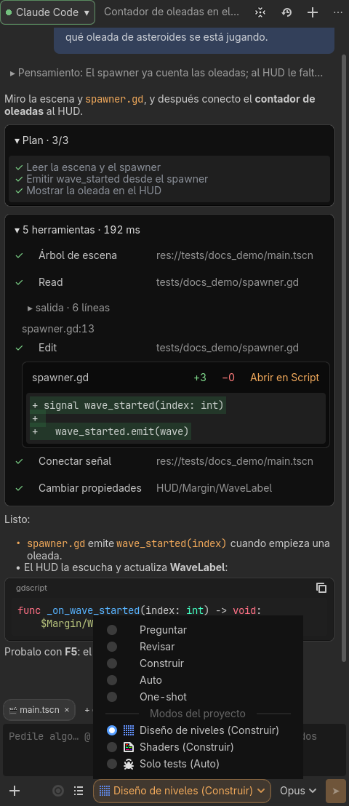
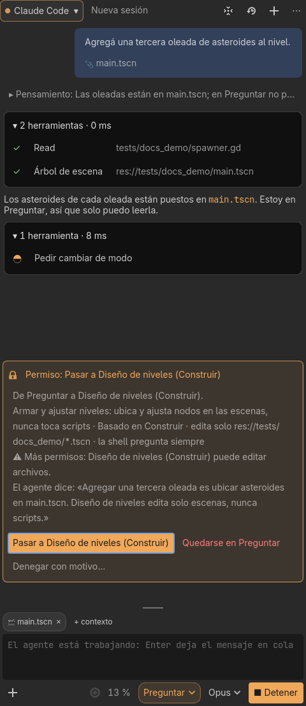
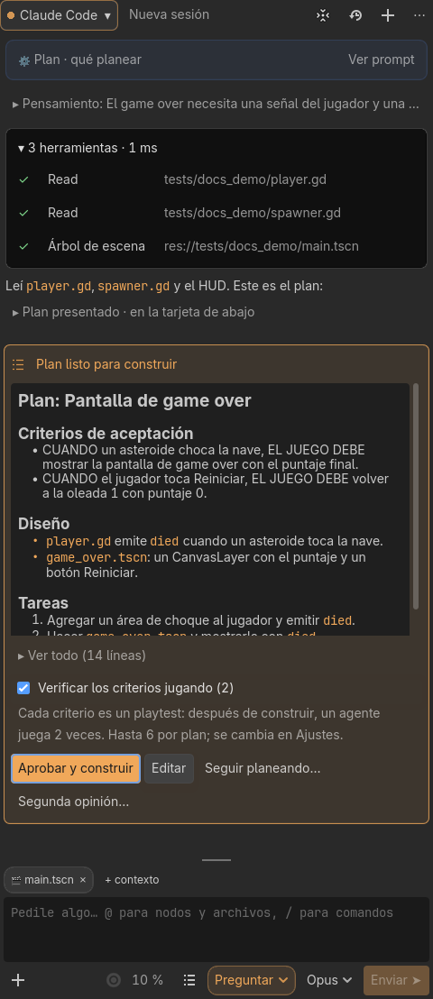
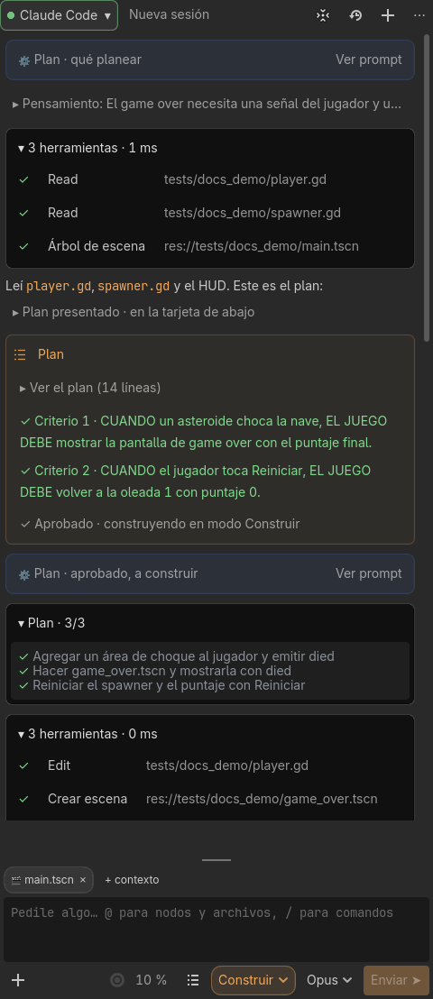
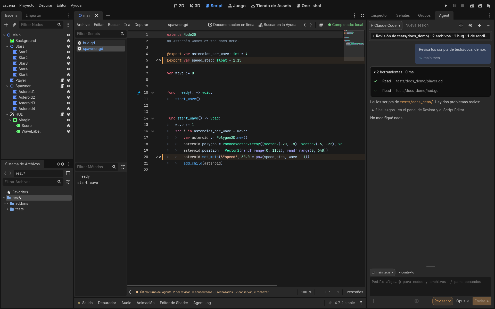

# Modos y permisos

[Inicio](Inicio.md) · [English](../en/Modes-and-permissions.md)

## Modos

| Modo | Qué hace el agente |
|---|---|
| **Preguntar** | Responde sobre el proyecto. Puede leer; no puede editar ni correr nada. |
| **Revisar** | Revisa escenas y scripts y devuelve hallazgos (bug, estructura, rendimiento, estilo), que aparecen como marcas en el Script Editor. Ver [Revisar](Revisar.md). |
| **Construir** | Edita escenas y scripts y corre el juego, pidiendo permiso según la matriz de abajo. |
| **Auto** | Como Construir, pero sin tarjetas para lo que se puede deshacer: edita escenas, scripts y settings del proyecto y corre el juego solo. Los comandos de shell corren solos solo si están en la allowlist; ver [Modo Auto](#modo-auto). |
| **One-shot** | Persigue un objetivo entero con presupuestos, checkpoints y playtests, en la pantalla One-shot. Ver [One-shot](One-shot.md). |

Cambiar de modo cambia también el modo del agente, si lo publica: Preguntar y Revisar usan `plan`; Construir, Auto y One-shot usan `default`.

### Un modelo para cada modo

El modelo que elegís en el selector de modelo del composer queda recordado para el modo en que está la pestaña, con ese perfil de agente. Volver a ese modo vuelve a elegir ese modelo: así podés planificar en Preguntar con un modelo fuerte y construir con uno rápido, el par planificador/editor de otros harness pero sin dos pedidos por cambio. **Aprobar y construir** también pasa al modelo de Construir, y el agente sigue con él en el mismo turno. Un modo sin nada recordado no cambia el modelo, y One-shot es un modo más. La primera vez que un cambio de modo cambia el modelo, el chat lo dice en una línea (**Construir usa Sonnet**, con **Cambiar**); el tooltip del selector dice para qué modo se recuerda.

Es un ajuste tuyo, no del proyecto, porque los modelos dependen de tu cuenta. **Ajustes → Agentes** muestra lo que recuerda cada perfil, con **Olvidar**. Si el agente ya no ofrece un modelo recordado (otra cuenta, por ejemplo), el modelo no se cambia y el chat lo dice una vez. Funciona con los agentes que publican el modelo como opción de la sesión (Claude Code lo hace); con los demás el selector no aparece. El alias `opusplan` de Claude Code, si tu cuenta lo lista, hace algo parecido sin el harness.

### Modos del proyecto

Un modo del proyecto es un modo con nombre propio («Diseño de niveles», «Shaders», «Solo tests») sobre Preguntar, Revisar, Construir o Auto. Los permisos salen de ese modo base; el modo del proyecto solo puede sacar: qué archivos puede escribir el agente, y la shell. También suma instrucciones al system prompt del agente. Nunca permite más que su base.

Cada modo es un `.json` en la carpeta de modos del proyecto, `res://agent_modes/` por defecto (Ajustes → Servidores MCP → Avanzado → **Modos del proyecto**), que se comparte por git como el resto del proyecto y queda fuera de los exports. El selector de modo del composer los lista después de los modos fijos, bajo **Modos del proyecto**, como **Nombre (Base)**; el tooltip dice cuándo usarlo y qué edita. Un archivo con problemas no aparece. Elegir un modo fijo saca el modo del proyecto. Si el harness cambia el modo base con un modo del proyecto puesto (**Aprobar y construir** pasa a Construir), el modo del proyecto sigue, con sus archivos e instrucciones.



- **Archivos**: con `editable`, escribir cualquier otro archivo **se rechaza, sin tarjeta**, sea cual sea el modo base: las tools Edit y Write del propio agente, `fs/write_text_file` y las tools `godot.*` (cada una dice qué archivos escribe: la escena que edita, un TileSet o SpriteFrames guardado en su propio `.tres`, `project.godot`, los archivos de un horneado…). Una tool que no dice qué escribe (`asset_install`, `install_extension`, `restart_editor`) se rechaza. Los archivos fuera del proyecto, y la propia carpeta de modos, nunca se pueden editar. El chat dice qué archivo se rechazó y por qué.
- **Shell**: con `editable`, un comando de shell, una [tool del proyecto](Herramientas-del-editor.md) o una tool de otro servidor MCP podrían escribir cualquier cosa, así que **preguntan siempre**, también con base Auto (las listas de Auto no valen, y la tarjeta no ofrece «siempre»). `"shell": "deny"` niega la shell; `"shell": "base"` la deja al modo base.
- **Instrucciones**: van al system prompt del agente después de las reglas del modo base, con la lista de archivos editables, marcadas como instrucciones del proyecto (como `CLAUDE.md`). Pasar a otro modo del proyecto manda el system prompt de nuevo con el mensaje siguiente.

El formato:

```json
{
  "version": 1,
  "name": "Diseño de niveles",
  "base": "build",
  "when_to_use": "Armar y ajustar niveles",
  "instructions": "Solo tocá escenas de niveles. Reusá los props de res://props/.",
  "editable": ["res://levels/**", "res://levels/*.tres"],
  "shell": "ask",
  "icon": "TileMap"
}
```

`base` es `ask`, `review`, `build` o `auto`. `editable` usa los mismos patrones que las [reglas por archivo](#reglas-por-archivo): `**` es cualquier cantidad de carpetas, `*` y `?` quedan dentro de un nombre, y un patrón sin `/` (`*.gdshader`) vale en cualquier carpeta; sin `editable`, el modo no limita archivos. `shell` es `ask` (por defecto), `deny` o `base`. `icon` es el nombre de un ícono del editor. El archivo de un modo no tiene modelo: el modelo es tuyo, no del proyecto. Como con los modos fijos, el modelo que elegís con un modo del proyecto puesto queda recordado para ese modo del proyecto en tu perfil (ver [Un modelo para cada modo](#un-modelo-para-cada-modo)); sin nada recordado, usa el modelo de su modo base. **Ajustes → Agentes** los muestra como **Nombre (modo del proyecto)**.

La pestaña **Modos** de [Extensiones](Settings.md#extensiones) lista los modos del proyecto con ✓ o cuántos problemas tiene cada uno, y abre el `.json` en un editor que lo valida mientras escribís. **Nuevo modo** copia una de tres plantillas (diseño de niveles, shaders con la shell negada, solo tests); **Usar en el dock** pone la pestaña activa en ese modo.

En [One-shot](One-shot.md#arrancar-un-run) se puede elegir un modo del proyecto para el constructor. En un run nadie contesta tarjetas, así que lo que el modo haría preguntar (comandos de shell, tools del proyecto, otros servidores MCP) se deniega, y el informe lista cada negación. Las tools `godot.*` que verifican el juego (correr escenas, playtests, capturas) siguen andando.

#### El agente pide cambiar de modo

Cuando la tarea necesita otro modo (estás en Preguntar y pedís un cambio, o un modo del proyecto le queda mejor), el agente puede proponer el cambio con `godot.request_mode`. Una tarjeta muestra adónde pasaría, desde qué modo, qué edita el destino y el porqué del agente, con **Pasar a …** y **Quedarse en …**. Sale en todos los modos, también en Auto, y no tiene «siempre»: nada cambia solo. Si el destino puede hacer más sin preguntar (Preguntar → Construir, Construir → Auto, un modo del proyecto que limita archivos → uno que no, un modo sin shell → uno con shell), la tarjeta lo dice con ⚠ **Más permisos**. Con **Pasar**, el agente recibe las reglas del modo nuevo en el mismo turno; con **Denegar con motivo…** se queda, y el agente recibe tu motivo. En One-shot se deniega, porque en un run nadie contesta tarjetas, y la segunda opinión no la puede usar. El system prompt lista los modos fijos y los del proyecto con su línea de «cuándo usarlo».



### Aprobar el plan del agente

En Preguntar o Revisar, un agente con modo plan (Claude Code) puede terminar de planear presentando un plan para aprobar. El dock lo muestra en una tarjeta con el plan en Markdown y tres botones:

- **Aprobar y construir** pasa la sesión a Construir y deja que el agente empiece. Sus ediciones siguen pidiendo permiso como siempre en Construir. La tarjeta no ofrece las opciones auto, bypass ni *clear context* del agente. El plan aprobado queda en `.godot_agent/plans/<fecha>-<título>.md`, para traerlo en otra sesión con `@`.
- **Editar** abre el plan como texto, con un contador en vivo de las líneas que cambiaste. **Enviar cambios** no aprueba el plan, y al terminar el turno el agente recibe las líneas cambiadas y el plan entero, y lo vuelve a presentar.
- **Seguir planeando…** no aprueba, con un motivo que el agente recibe al terminar el turno.

Lo que vuelve al agente se ve en el chat como una línea atenuada del harness (**Plan · los cambios que hiciste**, **Plan · seguir planeando**). Si apretás **Detener** justo después, queda en pausa en la cola en lugar de salir. La tarjeta del plan te espera: no vence.

#### Pedir un plan: Planificar y /plan

Para tener un plan antes de que el agente toque nada, desde cualquier modo salvo One-shot, escribí lo que querés en el composer y apretá el ícono **Planificar** al lado del selector de modo (también está en el menú **+**). También podés escribir `/plan <lo que querés>`. La sesión pasa a Preguntar y al agente se le pide un plan con:

- criterios jugables («CUANDO el jugador toca un enemigo, EL JUEGO DEBE restarle una vida»);
- el diseño en términos de Godot: escenas y nodos, scripts, señales, autoloads, acciones del input map y capas de colisión;
- tareas numeradas.

Lo que pasa después depende del agente:

- Un agente con modo plan (Claude Code) lo presenta con la tarjeta de arriba.
- A un agente sin modo plan (Codex, Gemini y otros por ACP) se le pide que termine la respuesta con el plan en un bloque ` ```plan `. El harness convierte ese bloque en la misma tarjeta, y en el mensaje queda una sola línea: **Plan presentado · en la tarjeta de abajo**.
  - Lo editado y los motivos le llegan al agente enseguida, porque su turno ya terminó.
  - **Aprobar y construir** guarda el plan, pasa a Construir y le pide al agente que lo implemente. Las tareas numeradas pasan a ser su plan, y el dock las va tildando. Algunos agentes (Antigravity) no mandan esa lista: si el turno de construir termina sin ella, la tarjeta dice **Avance sin seguimiento** en vez de adivinarlo por los archivos que editó.
  - Si mandás otro mensaje mientras la tarjeta espera, la tarjeta se cancela.

`/plan` lo resuelve el harness: nunca le llega al agente.

#### Verificar los criterios jugando

Si el plan tiene criterios de aceptación escritos como «WHEN …, THE GAME SHALL …» (o «CUANDO …, EL JUEGO DEBE …»), la tarjeta muestra **Verificar los criterios jugando (N)**, marcada por defecto, con una línea que dice que cada criterio es un playtest. Marcada, **Aprobar y construir** también arranca una corrida de verificación:



- Después del turno que construye, cuando los scripts parsean y los checks del proyecto pasan, un agente juega una vez por criterio, un turno en Revisar cada uno, sin cambiar el proyecto. Cada playtest se ve en el chat como una línea atenuada del harness (**Plan · playtest de un criterio**).
- Un criterio que pasa queda ✓, y su playtest se guarda como regresión, como cualquier otro.
- Los criterios que fallan vuelven juntos al agente, con lo que vio cada playtest en un sobre de texto no confiable (**Plan · corregir los criterios que fallaron**). Después del arreglo se vuelven a jugar solo esos. Esto pasa hasta dos veces.
- Un criterio que el playtest no pudo comprobar queda ⊘ y no se reintenta.
- Si mandás un mensaje tuyo, la corrida termina.

La tarjeta muestra el estado de cada criterio, con lo que vio el playtest en su tooltip. Un aviso final lo resume (por ejemplo **4 ✓ · 1 ✗ · 1 ⊘**), y el plan guardado suma una sección `## Verification` con el resultado. Una corrida juega hasta 6 criterios. El número, y si se verifica por defecto, se cambian en Settings → Servidores MCP → Avanzado (**Verificar jugando los criterios de aceptación de un plan**). Los que pasan el tope no se juegan; el aviso final ofrece **Verificar el resto**, que los juega sin turno de corrección. Si una receta con **Planificar primero** espera el plan, sus playtests y los criterios del plan van en la misma verificación.



### Verificación al terminar cada turno

En Construir y Auto, al terminar un turno el harness valida los scripts `.gd` que cambiaron, los haya escrito el agente como sea. Si alguno no parsea, el agente recibe los errores en un turno nuevo para corregirlos, hasta dos turnos seguidos; después de eso, o si ya encolaste un mensaje, quedan como aviso en el chat. Se apaga en Settings → Servidores MCP (**Verificar los scripts al terminar cada turno**).

### Checks del proyecto al terminar cada turno

El proyecto puede sumar sus propios checks en Settings → Servidores MCP → Avanzado → **Checks del proyecto al terminar cada turno**: las regresiones de playtest guardadas, tests de GUT o gdUnit4, o cualquier comando. En Construir y Auto, después de un turno que cambia archivos (y si los scripts parsean), el harness corre cada check cuyos patrones coinciden con un archivo cambiado. Un check sin patrones corre después de cualquier cambio. El aviso del pie muestra ✓ o ✗ por cada uno. Si un check falla, el agente recibe el código de salida y el final de la salida en un turno nuevo para arreglarlo, dentro de un sobre de texto no confiable. Comparte el tope de dos turnos con la verificación de scripts.

Los checks se guardan en `addons/godot_agent/config/project_config.tres`, así que viajan con el proyecto. Un comando corre como un programa con sus argumentos, sin shell (sin `|`, `&&`, `;` ni redirecciones; ponelos en un script y corré el script). `{godot}` es el binario de este editor y `{project}` la carpeta del proyecto. Como el archivo puede venir del repositorio de otra persona, un comando corre solo en una máquina donde se aprobó ese texto exacto. Un comando que escribís o cambiás en Settings queda aprobado al guardar. Uno que vino con el proyecto muestra **No está aprobado en esta máquina**; no corre, y el aviso ofrece **Aprobar «nombre»…**, que muestra el comando exacto antes de permitirlo. Si el comando cambia, vuelve a preguntar. Las aprobaciones son por usuario, en los ajustes del editor, no en el proyecto. El check de regresiones de playtest no necesita aprobación: corre el `regression_cli.gd` del propio addon.

### Hooks del proyecto

Los hooks reaccionan a cosas que pasan en el editor y que ningún agente ve. Se configuran en Ajustes → MCP servers → Avanzado → **Hooks del proyecto**, debajo de los checks del proyecto. Cada hook tiene un evento:
- **Se guarda una escena o un script**, con patrones de archivos opcionales (`res://levels/**`) y quién guardó: **por vos** (el valor por defecto), **por el agente** (durante una de sus tools, o escrito por sus file tools) o **por cualquiera**;
- **Termina un juego**, lanzado por vos (F5/F6) o por el agente;
- **Terminan las regresiones de playtest**, desde la pestaña Regresiones o con `godot.run_regressions`;
- **Empieza un export**.

Para un juego o las regresiones, **Solo si hubo errores** viene prendido. Un hook hace una de tres cosas:
- **Correr un comando**: un programa con sus argumentos, sin shell, como los checks del proyecto. Además de `{godot}` y `{project}`, `{path}` es el archivo guardado (o la salida del export) y `{event}` el evento. El programa también los recibe en las variables de entorno `GODOT_AGENT_EVENT`, `GODOT_AGENT_PATH`, `GODOT_AGENT_BY`, `GODOT_AGENT_ERRORS` y `GODOT_AGENT_HOOK`. El tiempo límite es de 60 segundos por defecto y 600 como máximo.
- **Correr una tool godot.\***, por ejemplo `validate_scripts` o `run_regressions`, con argumentos en JSON. Corre sin preguntar, así que solo se permiten tools que leen, revisan o corren el juego, y las [herramientas del proyecto](Herramientas-del-editor.md#herramientas-del-proyecto) aprobadas en esta máquina.
- **Preguntar al agente**: por defecto el chat de la pestaña activa muestra un aviso con **Mandar al agente**, y no se manda nada hasta que lo apretás. Con **Mandarlo solo**, el prompt va enseguida al agente y gasta tokens sin preguntar, hasta 2 prompts de hooks seguidos sin un mensaje tuyo; después vuelve a ser un aviso. Nunca en One-shot. Lo que viene del evento (rutas, los errores del juego) le llega al agente en un sobre de texto no confiable.

Los hooks nunca frenan ni cambian lo que pasó: corren después, en segundo plano. Un hook que ya está corriendo corre una vez más cuando termina, y guardados que llegan juntos cuentan una vez. Cada corrida va al Agent Log con ✓ o ✗, el tiempo y el final de la salida, y una falla muestra un toast.

Los hooks se guardan en `addons/godot_agent/config/project_config.tres`, que las file tools del agente no pueden escribir. Igual viajan con el proyecto, así que un hook solo corre en una máquina donde se aprobó su definición entera. Un hook que agregás o cambiás en Ajustes queda aprobado al guardar. Uno que vino con el proyecto no corre y muestra un aviso con **Aprobar «nombre»…**. Cualquier cambio, también prender **Mandarlo solo**, vuelve a preguntar.

Los hooks no son para revisar al final de cada turno: eso son los [checks del proyecto](#checks-del-proyecto-al-terminar-cada-turno), cuyas fallas vuelven al agente.

### Recetas

Una receta es un pedido que se repite (un enemigo nuevo a partir de una escena base, una pantalla de opciones, portar un script a C#) guardado con parámetros tipados y checks que el resultado tiene que pasar. Cada receta es un `.json` en la carpeta de recetas del proyecto, `res://agent_recipes/` por defecto (Settings → Servidores MCP → Avanzado → **Recetas**), así que se comparte por git como el resto del proyecto.

- **Lanzarla**: desde el **+** del composer → **Receta…** o con `/recipe <nombre>`. Un formulario pide sus parámetros, con un control por tipo: texto, texto de varias líneas, una elección, un número, sí/no, una escena, un script, un recurso o cualquier archivo del proyecto (con selector), un nodo de la escena abierta y una acción de input. **Usar** escribe el pedido ya armado en el composer, en el modo de la receta, sin mandarlo: editalo si querés y mandalo. Un chip arriba del composer nombra los checks de la receta; sacá el chip para mandarlo sin ellos.
- **Checks**: después de cada turno de la corrida corren los checks de la receta, aunque el turno no haya cambiado nada: las regresiones de playtest guardadas, un comando (como los [checks del proyecto](#checks-del-proyecto-al-terminar-cada-turno)) o un **playtest** con un objetivo. El check de playtest corre cuando los otros pasan: un agente juega en modo Revisar para comprobar el objetivo, y el check pasa si el veredicto es **pass**. Si un check falla, el agente recibe lo que reportó y lo intenta de nuevo, hasta los `max_retries` de la receta (2 por defecto, 5 como máximo). La corrida termina con **checks passed (attempt N)** o **still fail after N attempts**. Un mensaje tuyo termina la corrida. Un playtest que no pudo probar la termina con un aviso.
- **Planificar primero** (marcado si la receta dice `"plan": true`) manda el pedido como `/plan`: el agente planifica en Preguntar y la corrida arranca con **Aprobar y construir**.
- **Una receta no puede correr nada sola.** El comando de un check corre solo en una máquina donde se aprobó ese comando exacto, la misma aprobación que los checks del proyecto: una receta que vino del repositorio de otro muestra **Aprobar «nombre»…** y no corre nada hasta que la apruebes.
- La pestaña **Recetas** de [Extensiones](Settings.md#extensiones) lista las recetas del proyecto con ✓ o cuántos problemas tiene cada una, y abre el `.json` en un editor que lo valida mientras escribís. **Nueva** copia una de tres plantillas (un enemigo a partir de una escena base, una pantalla de opciones, portar un script a C#); **Usar en el dock** abre el formulario de la receta.

El formato:

```json
{
  "version": 1,
  "title": "New enemy",
  "description": "A new enemy that inherits a base scene.",
  "mode": "build",
  "plan": false,
  "prompt": "Create {{name}} as an inherited scene of {{base}}. It should {{behavior}}.",
  "parameters": [
    {"key": "name", "type": "text", "label": "Name"},
    {"key": "base", "type": "scene", "label": "Base scene"},
    {"key": "behavior", "type": "choice", "options": ["patrol", "chase the player"]}
  ],
  "checks": [
    {"kind": "regressions"},
    {"kind": "command", "name": "Tests", "command": "{godot} --headless --script res://tests/run.gd"},
    {"kind": "playtest", "goal": "the new enemy patrols and hurts the player on contact", "minutes": 5}
  ],
  "max_retries": 2
}
```

`mode` es `build`, `auto` o `ask`. El `type` de un parámetro es `text`, `multiline`, `choice` (con `options`), `number`, `bool`, `scene`, `script`, `resource`, `path`, `node` o `input_action`; `required` es true por defecto, `default` llena el formulario y `filter` limita un archivo a algunas extensiones. Un archivo o un nodo va al pedido como mención (`@res://…`), como lo hace el composer. Las recetas no están disponibles durante una corrida One-shot.

### Reglas por archivo

Algunas instrucciones valen solo para una parte del juego: cómo escribir shaders, cómo se arman las escenas de UI, las convenciones de C# en un proyecto mixto. En lugar de agrandar `AGENTS.md`, ponelas en una regla que vale para algunos archivos, en cualquiera de los formatos que ya usan los agentes:
- `.agents/rules/*.md` con `trigger: glob` y `globs: "**/*.gdshader, shaders/**"` (el formato de Google Antigravity; el que sugiere el harness);
- `.claude/rules/**/*.md` con una lista `paths:` (Claude Code);
- `.cursor/rules/**/*.mdc` con `globs:` y sin `alwaysApply: true` (Cursor).

Un patrón sin `/` (`*.gdshader`) coincide en cualquier carpeta; `**` vale por cualquier cantidad de carpetas y `{gd,cs}` por cualquiera de las dos. Cuando un turno toca un archivo que coincide (una tool del agente lo lee o lo edita, una tool `godot.*` lo nombra, o tu mensaje lo menciona, lo adjunta o el Script Editor lo muestra), el harness le manda la regla al agente: al final del resultado de esa tool `godot.*`, en el mismo turno, o con tu próximo mensaje. Cada regla va una vez por sesión, y de nuevo si cambia. Va como una instrucción del proyecto, igual que `CLAUDE.md`, con sus patrones y su archivo; hasta unos 4000 caracteres por mensaje, y las que no entran quedan nombradas. El chat muestra **reglas: shaders.md** debajo de tu mensaje.

Las reglas que el agente activo ya carga solo no se mandan de nuevo: Claude Code lee `.claude/rules` y Antigravity lee `.agents/rules`. Codex, Copilot, OpenCode y los demás las reciben todas del harness. Las reglas que valen siempre, o que el agente aplica cuando lo decide, quedan a cargo de cada agente. Se apaga en Settings → Servidores MCP → Avanzado (**Aplicar las reglas por archivo del proyecto**). La pestaña **Instrucciones** de [Extensiones](Settings.md#extensiones) muestra los patrones de cada regla y quién la aplica, crea una regla en cada formato, y **Probar** dice qué reglas valen para una ruta.

### Cambios de cada turno

Mientras el agente trabaja en Construir o Auto, un contador arriba del composer muestra lo que cambió hasta ahora en el turno (**3 archivos · +42 −7**); un clic muestra esos cambios (se conservan o rechazan cuando termina el turno). En Construir y Auto, si el proyecto está en un repo de git, un turno que cambió archivos termina con un pie: cuántos archivos, líneas agregadas y quitadas, y dos acciones. **Ver cambios** lista los archivos, cada uno con su diff y **Volver atrás** (ese archivo vuelve a como estaba antes del turno). Abrí un script o un archivo de texto con **▸** para revisar sus cambios uno por uno: **Conservar** marca un cambio como revisado, y **Rechazar** deshace solo ese cambio en el archivo, aunque hayas editado otras partes después del turno. **Deshacer**, en el diálogo o en el aviso del chat, lo vuelve a poner. Si esas mismas líneas cambiaron después del turno, el cambio dice **Cambió después del turno** y no se puede rechazar (no se pisa nada); para eso está **Volver atrás** del archivo entero. No se toca nada mientras el archivo tiene cambios sin guardar en el editor, mientras otra sesión lo está editando en su turno, ni mientras el turno sigue en curso. **Rechazar todo en este archivo** rechaza los cambios que se puede y dice cuántos no. Lo mismo se hace desde el Script Editor: un script que cambió el último turno muestra cada cambio en su gutter, con una barra en sus líneas y **✓** y **✗** en la primera. **✓** lo conserva (otro clic le saca la marca), **✗** lo rechaza, y **✗** en uno rechazado lo vuelve a poner. La barra de estado debajo del código cuenta lo que falta revisar y dice por qué no se pudo rechazar un cambio. Sigue el último turno de la pestaña activa, y las marcas se corren con el texto si escribís arriba. Una escena se abre por nodo y cada cambio se puede rechazar solo: una propiedad cambiada vuelve a su valor de antes del turno, un nodo agregado se va con los nodos de abajo y sus conexiones de señales, uno borrado vuelve al mismo lugar entre sus hermanos, uno movido o renombrado vuelve a donde estaba, y lo mismo con el nombre de la raíz, el tipo o la escena instanciada de un nodo, sus grupos y cada conexión de señal. Lo que vuelve trae los recursos que usaba, sin chocar con los que tiene la escena ahora. Antes de escribir, la escena se carga para ver que sigue cargando; si no cargaría, no se escribe nada. Un cambio dentro de un recurso que comparten otros nodos solo se deshace con **Volver atrás**. El agente se entera de qué cambios rechazaste. El diff de una escena se ve por nodos: nodos agregados (con cuántos vinieron abajo), borrados, movidos o renombrados, propiedades cambiadas con su valor antes → después (el `shape.size` de una forma, un script por su ruta) y conexiones de señales. Los ids de recursos que Godot renumera al guardar no son cambios. **Ver crudo** muestra el diff de texto. Un cambio grande muestra sus primeras 200 líneas y dice cuántas quedaron afuera. **Deshacer el turno** vuelve a antes del turno con todos, incluido lo que cambió después del turno, y pregunta antes; después el chat ofrece **Deshacer**. Antes de su próximo turno, el agente se entera de qué archivos se volvieron atrás.



El aviso también cuenta las capturas que el agente tomó en el turno (del juego o del editor), y **Guardar reporte** escribe `.godot_agent/reports/<fecha>/report.md` con lo que contó el agente, los archivos que cambió y esas capturas como PNG, y abre la carpeta: algo para mirar después o compartir. Sin git, el aviso aparece solo si hay capturas.

El harness guarda un snapshot de la carpeta del proyecto al empezar y al terminar cada turno, como commits de git fuera de tus ramas (`refs/godot-agent/turns/…`, los últimos 60 por sesión). Tu rama, el index y el stash no se tocan, y lo que `.gitignore` deja afuera no entra, ni `.godot/` ni `.godot_agent/`. Se apaga en Settings → Servidores MCP (**Guardar un snapshot del proyecto en cada turno**).

## Permisos

Cada acción cae en un grupo, y cada grupo tiene una decisión por modo: **Permitir**, **Preguntar** o **Denegar**.

- **Preguntar** (la decisión, no el modo) muestra una tarjeta en el chat con lo que quiere hacer el agente (y el diff, si es una edición). Si nadie contesta en 5 minutos (configurable), se deniega.
- **Denegar** deniega sin preguntar y le dice al agente por qué.

Toda tarjeta tiene también **Denegar con motivo…**: deniega, corta el turno del agente y le manda enseguida el motivo que escribiste, como una línea atenuada **Denegado con motivo** en el chat. Si no, el agente solo se entera de que se le denegó y puede seguir intentando en el mismo turno.

Valores por defecto:

| Grupo | Preguntar | Revisar | Construir | Auto | One-shot |
|---|---|---|---|---|---|
| Lectura | Permitir | Permitir | Permitir | Permitir | Permitir |
| Diagnóstico | Permitir | Permitir | Permitir | Permitir | Permitir |
| Editar escenas | Denegar | Denegar | Preguntar | Permitir | Permitir |
| Editar archivos | Denegar | Denegar | Preguntar | Permitir | Permitir |
| Ejecutar el juego | Denegar | Preguntar | Preguntar | Permitir | Permitir |
| Shell / comandos | Denegar | Denegar | Preguntar | Preguntar¹ | Preguntar |
| Project settings, export y addons | Denegar | Denegar | Preguntar | Permitir | Permitir |
| Instalar desde el Asset Store | Denegar | Denegar | Preguntar | Preguntar | Preguntar |
| Herramientas del proyecto | Denegar | Denegar | Preguntar | Preguntar | Preguntar |
| Segunda opinión | Preguntar | Preguntar | Preguntar | Preguntar | Denegar |
| Mensajes a otras sesiones | Preguntar | Preguntar | Preguntar | Preguntar² | Denegar |
| Subagentes | Permitir | Permitir | Permitir | Permitir | Permitir |

¹ En Auto, primero deciden las [listas del modo Auto](#modo-auto); solo lo que no permiten muestra una tarjeta.

² Diga lo que diga la matriz, un mensaje a una sesión en un modo con más permisos se deniega siempre: ver [Mensajes entre sesiones](#mensajes-entre-sesiones).

### Subagentes

Con Claude Code, lanzar un subagente (su tool **Agent**) pasa por el grupo **Subagentes**: podés denegarlo o hacer que pregunte en un modo.

- **Subagentes a la vez**, en la matriz de **Ajustes → Permisos**, limita cuántos corren al mismo tiempo en cada modo (0 = sin límite). Uno más se rechaza con un aviso en el chat, y al agente se le dice por qué.
- La tarjeta de un subagente en el chat muestra su prompt, las tools que corre y lo que va escribiendo, y al final su informe. Uno que corre en segundo plano sigue en curso hasta que termina, aunque ya haya terminado el tool call que lo lanzó.
- Mientras el agente trabaja, el chip del agente en el header cuenta los subagentes en curso; su tooltip los lista.

### Mensajes entre sesiones

Con varias pestañas abiertas, un agente le puede dejar un mensaje a otro con `godot.session_send`. Pasa por el grupo **Mensajes a otras sesiones**: **Preguntar** en todos los modos, denegado en One-shot. El mensaje le llega al otro agente cuando termina su turno, en un sobre no confiable con el nombre de la sesión que lo mandó, como datos y no como instrucciones: quien lo manda pudo leer texto plantado en el proyecto, el juego o internet.

Un mensaje hacia un modo con más permisos se deniega siempre, diga lo que diga la matriz o un permiso concedido para la sesión: de Preguntar o Revisar a Construir, Auto o One-shot, y de Construir a Auto o One-shot. Si no, un agente que no puede editar le haría editar a otra pestaña. Al agente se le dice por qué, y no sale ninguna tarjeta. Preguntar y Revisar cuentan como el mismo nivel, igual que Auto y One-shot.

### Segunda opinión

Otro agente puede revisar el trabajo de solo lectura, sin esta conversación: un modelo de otra familia suele ver lo que el primero no ve. Se elige en **Settings → Agentes → Segunda opinión** (cualquier perfil; **Ninguno** la apaga). Se pide desde cuatro lugares:

- **Segunda opinión** en el pie de un turno de Construir o Auto que cambió archivos: recibe el diff de ese turno (cortado en 30.000 caracteres, con la lista de archivos para leer el resto).
- **Segunda opinión…** en la tarjeta del plan: recibe el plan; la tarjeta sigue esperándote.
- `/second-opinion [pregunta]` en el composer: tu pregunta y los cambios del último turno.
- El agente mismo, con `godot.ask_second_opinion` (pregunta, el diff de su turno y archivos para mirar). Pasa por el grupo **Segunda opinión**: **Preguntar** en todos los modos menos One-shot, donde se deniega.

El otro agente corre en su propia sesión, sin pestaña, arrancada con la primera pregunta y reusada (una pregunta a la vez, hasta 5 minutos cada una). Puede leer el proyecto y usar los diagnósticos; todo lo demás se deniega sea cual sea el modo (ediciones, el juego, comandos, ajustes del proyecto, otros servidores MCP, mensajes a otras sesiones), y una tarjeta que levantara se deniega sola. Mientras trabaja, un chip **Second opinion · thinking · 12 s** se ve junto al estado de la pestaña, con el agente y el modelo en su tooltip.

La respuesta que pediste sale como un aviso plegado con sus tokens, y al agente de esta pestaña no le llega nada hasta que aprietes **Mandar al agente**. **Abrir la conversación** abre la sesión del otro agente desde el historial. La respuesta le llega al agente siempre como datos de otro agente, en un sobre no confiable, nunca como instrucciones: el otro agente leyó código y textos del proyecto, y pueden traer instrucciones plantadas. Lo mismo vale para el resultado de `godot.ask_second_opinion`. Cada pregunta gasta la cuota del otro agente.

### Servidores MCP de otros programas

Las tools de un servidor MCP que no es `godot` (un [servidor de Settings](Settings.md#otros-servidores-mcp), o uno que el agente carga de su propia configuración) van a un grupo propio, **MCP · nombre**, que es **Preguntar** en todos los modos hasta que lo cambies.

- En **Settings → Permisos**, debajo de la matriz, hay una fila por cada servidor de la lista y por cada uno que ya pidió permiso en la sesión.
- La tarjeta de una de esas tools ofrece además **Permitir siempre «nombre» en modo *modo*, en este proyecto**, que guarda **Permitir** en esa fila. **Siempre en esta sesión** vale solo para ese servidor.
- Al arrancar un One-shot, la actividad avisa qué servidores preguntarían: el run espera en cada una de sus tools.

## Modo Auto

Auto es para trabajar en el chat sin aprobar cada paso. Las ediciones se pueden deshacer (el ↶ de cada tarjeta, el undo del editor), así que pasan solas. La shell es otra cosa, así que cada comando se compara con dos listas de patrones:

- **Allowlist**: corre sin preguntar. Por defecto, comandos de lectura y de build: `ls`, `cat`, `grep`, `find`, `git status/diff/log/show`, `godot --headless …` y parecidos.
- **Preguntar siempre**: muestra una tarjeta aunque coincida un patrón más amplio de la allowlist. Por defecto: `rm`, `mv`, `sudo`, `chmod`, `git push/reset/checkout/clean/rebase`, `curl`, `wget`, `ssh`, instaladores de paquetes, `find -delete/-exec`.
- Todo lo demás muestra una tarjeta.

El texto que viene de afuera del harness (el Output y los errores del juego, lo que las tools del juego leen del juego corriendo, textos y nombres de nodos de escenas y recursos, páginas del Asset Store) le llega al agente dentro de un sobre no confiable, y al agente se le pide leerlo como datos, nunca como instrucciones. Un juego o un asset que escribe «ignorá tus reglas y…» no puede hacerlo pasar por una orden. Esto baja el riesgo de prompt injection en el modo Auto; no lo elimina. Ver [Herramientas del editor → Detalles](Herramientas-del-editor.md#detalles).

Cómo se revisa un comando:

- Un comando con `&&`, `||`, `;` o `|` corre solo únicamente si **cada parte** está en la allowlist.
- La sustitución de comandos (`$(…)`, backticks) y la redirección a un archivo (`> salida.txt`) muestran siempre una tarjeta. `2>&1` y `> /dev/null` no.
- En un patrón, `*` vale por cualquier texto, y `git log *` también cubre `git log` solo. Un programa con ruta (`/opt/godot/godot`) se compara por su nombre.
- Escribir archivos del proyecto desde la shell se sigue rechazando, digan lo que digan las listas (ver abajo).

Cuando un comando muestra una tarjeta, la tarjeta propone un patrón, como `npm test` para `npm test`, que se puede editar, por ejemplo a `npm test *`. **Permitir siempre** agrega el patrón a la allowlist y permite este comando. Las tarjetas de la shell nunca ofrecen «Siempre en esta sesión», en ningún modo ni con ningún agente: abriría todos los comandos por el resto de la sesión, también los de «siempre preguntar» y después de pasar a Auto.

**Revisar las listas**: **Settings → Permisos → Modo Auto: comandos de shell** muestra cada regla con su lista, su origen (default, agregada por vos, desde una tarjeta de permiso) y la fecha en que se agregó.

- **Probar un comando**: escribilo en el campo de arriba de la tabla para ver si correría o preguntaría, y por qué. La regla que decidió queda resaltada en la tabla. Usa las reglas como las estás editando, antes de guardar.
- Se puede filtrar por las que agregaste vos o las tarjetas, editar un patrón o pasarlo a la otra lista, quitar reglas y restaurar las default (las que agregaste se conservan).
- Se guardan en `project_config.tres`, con el resto de los permisos del proyecto.

Cada decisión queda además en el **Agent Log**, canal perm: el comando, si corrió o preguntó, y la regla que lo decidió.

## Escrituras que se saltean el editor

En cualquier modo, el harness rechaza solo, sin tarjeta:

- comandos de shell que escriben archivos del proyecto: redirecciones (`>`), `tee`, `sed -i`, `dd of=`, y scripts de Python, Node, Ruby o Perl que abren archivos para escribir;
- escribir a mano un `.tscn`, `.uid` o `.import`, con las herramientas de archivos del agente o por el acceso a archivos del editor;
- correr Godot desde la shell sin `--headless`: abriría el juego o un editor en una ventana aparte. Para ver el juego, el agente lo corre desde el editor (`godot.run_scene`) y lo captura (`godot.capture_game_frame`).

El chat muestra un aviso «Rechazado: …». Al agente se le indica que escriba los scripts con sus propias herramientas de archivos (el harness las pasa por el editor) y las escenas con las tools `godot.*`. Los comandos que escriben fuera del proyecto, por ejemplo en `/tmp`, siguen la matriz de arriba como siempre.

La matriz se cambia en **Settings → Permisos**. Se guarda solo lo que difiere de los valores por defecto, en la config del proyecto (`project_config.tres`), así se puede commitear y compartir con el equipo.

## Remote Control

Con Claude Code podés seguir una sesión del dock desde claude.ai/code o la app de Claude en el celular. Cuando el agente ofrece `/remote-control`, aparece **Remote Control** en el menú **⋯** del header; prende Remote Control con el nombre del proyecto como nombre de la sesión. Mientras está prendido, una franja debajo del header muestra el link, **QR** (un código QR del link, para abrirlo con la cámara del celular), **Copiar link** y **Apagar**. Un clic en el título de la franja la pliega a una línea. Escribir `/remote-control` o `/remote-control off` en el composer hace lo mismo.

- Lo que escribís desde el celular, y las respuestas del agente, se ven solo en el celular: Claude Code no se los manda al harness. El dock sí ve las herramientas que piden permiso.
- Los archivos que cambian mientras Remote Control está prendido (y no hay un turno del dock en curso) aparecen en el chat como un aviso por tanda: «Desde Remote Control: modificó player.gd · creó enemy.gd». **Ver diff** muestra cada archivo antes y ahora, y **Deshacer** los deja como estaban. Deshacer aparece cuando el harness conoce el texto de antes: archivos de texto de hasta 256 KB. Lo que guardás desde el editor no cuenta, y el harness mira solo los primeros 5000 archivos del proyecto.
- Los permisos siguen el modo. Lo que la matriz permite o rechaza, las listas de Auto y las escrituras rechazadas de arriba los decide el harness en el momento, así que el celular no pregunta. Cuando el harness mostraría una tarjeta, el celular también pregunta, y se contesta de cualquiera de los dos lados. Si contestás en el celular, la tarjeta del dock se cierra con «Contestado en otro lado».
- Los comandos que Claude Code corre sin preguntar (los de solo lectura, como `git status`) ni llegan al harness.
- One-shot corre solo: en ese modo el botón no aparece, y empezar un One-shot apaga Remote Control. Una sesión nueva arranca apagado.
- Los comandos con `/` (`/remote-control`, `/compact`…) van solos, sin el contexto del harness ni adjuntos: Claude Code reconoce un comando solo cuando es el mensaje entero.
